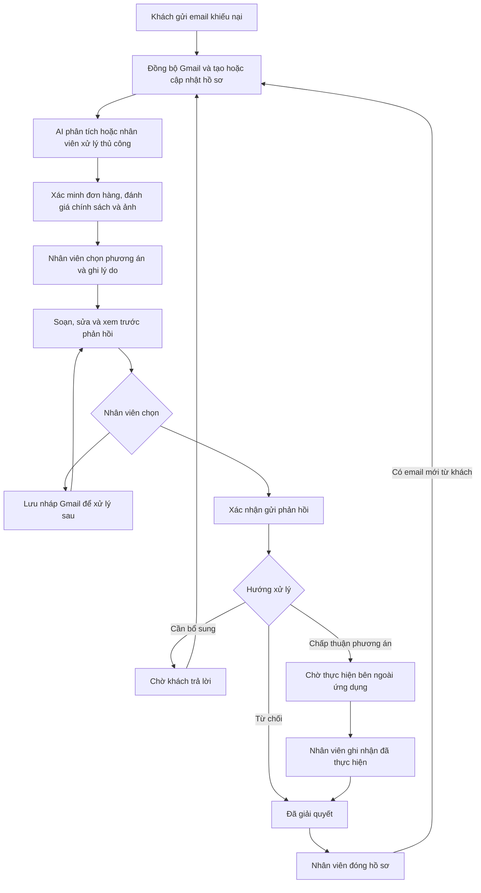

# CLAIMPILOT — Tổng quan dự án, chức năng, quy trình và phân công

> Tài liệu tổng quan để cả nhóm hiểu cùng một sản phẩm. Các chức năng bên dưới mô tả **MVP đích cần hoàn thiện**, không khẳng định tất cả đã được code hoặc chạy thành công. Chi tiết triển khai theo bộ docs hiện hành.

## 1. Dự án giải quyết vấn đề gì?

ClaimPilot là nền tảng AI hỗ trợ doanh nghiệp xử lý khiếu nại khách hàng qua Gmail, từ lúc tiếp nhận đến khi phản hồi và đóng hồ sơ.

Thông thường, nhân viên phải đọc email, tìm mã đơn, tra thông tin giao hàng, xem ảnh, đối chiếu chính sách rồi soạn câu trả lời. Nếu khách bổ sung thông tin, nhân viên lại phải nối các email và kiểm tra từ đầu. Quy trình thủ công dễ chậm, bỏ sót và xử lý thiếu nhất quán.

ClaimPilot tập hợp các thông tin này vào một hồ sơ, dùng AI hỗ trợ phân tích và soạn phản hồi, còn nhân viên kiểm tra và quyết định cuối cùng.

**Người dùng chính:** nhân viên chăm sóc khách hàng của doanh nghiệp bán hàng trực tuyến và bán lẻ vừa, nhỏ.

**Mục tiêu hackathon:** xây sản phẩm đúng quy trình, triển khai trên **Google Cloud Run**, với ba thành viên đều làm fullstack. Khung kế hoạch: **14/11/2026, 07:30–11:30**.

## 2. Các chức năng chính

| Nhóm chức năng | Người dùng làm được gì? |
|---|---|
| Đăng nhập | Đăng nhập, đăng xuất và truy cập hồ sơ qua phiên nhân viên được bảo vệ |
| Kết nối Gmail | Đồng bộ thủ công hoặc theo lịch năm phút; xem lần đồng bộ thành công gần nhất và lỗi |
| Quản lý hồ sơ | Xem danh sách, lọc trạng thái, mở toàn bộ cuộc trao đổi và thông tin liên quan |
| Phân tích văn bản bằng AI | Nhận diện khiếu nại, trích mã đơn, yêu cầu khách, mức ưu tiên, tóm tắt và thông tin còn thiếu |
| Xác minh đơn hàng | Tra PostgreSQL, kiểm tra trạng thái/ngày giao và đối chiếu email người gửi với chủ đơn |
| Đánh giá chính sách | Áp dụng năm nhóm quy tắc, trả lý do, thông tin cần bổ sung và bước tiếp theo |
| Bằng chứng ảnh | Xem ảnh đơn hàng và ảnh khách gửi; Gemini nhận xét một phía hoặc đối chiếu hai phía |
| Xử lý thủ công | Nhân viên sửa dữ liệu AI nhận sai, xác minh thủ công có căn cứ và tiếp tục khi AI lỗi |
| Quyết định | Chấp thuận, từ chối hoặc yêu cầu bổ sung; chọn phương án cụ thể và ghi lý do |
| Phản hồi | Soạn bằng AI hoặc thủ công, sửa nội dung, xem trước rồi gửi hoặc lưu Gmail Draft |
| Theo dõi thực hiện | Ghi nhận việc đổi hàng/hoàn tiền/kiểm tra vận chuyển đã làm ngoài ứng dụng |
| Lịch sử và đóng hồ sơ | Xem email, quyết định, thay đổi và thao tác; đóng hoặc mở lại hồ sơ khi cần |

### Năm nhóm khiếu nại

1. Giao hàng trễ.
2. Chưa nhận được hàng.
3. Hàng hóa bị hư hỏng.
4. Giao sai hàng.
5. Yêu cầu hoàn tiền.

**Vấn đề, mong muốn khách hàng và phương án doanh nghiệp là ba thông tin khác nhau.** Ví dụ: vấn đề là hàng hư hỏng, khách muốn hoàn tiền, nhưng sau trao đổi doanh nghiệp và khách thống nhất đổi hàng.

Các thời hạn xử lý là cấu hình chính sách mẫu có phiên bản, không mặc định là chính sách đúng cho mọi doanh nghiệp. Kết quả AI và policy chỉ hỗ trợ nhân viên xem xét.

## 3. Quy trình hoạt động của sản phẩm

### Bước 1 — Tiếp nhận và gom cuộc trao đổi

Nhân viên đăng nhập. Hệ thống đọc Gmail theo lịch hoặc khi nhân viên bấm đồng bộ, rồi tạo hồ sơ cho khiếu nại mới.

Một hồ sơ có nhiều email. Khách trả lời cùng cuộc hội thoại để bổ sung ảnh hoặc thông tin thì email mới được gắn vào hồ sơ cũ. Không tạo một hồ sơ mới cho mọi lần khách trả lời; cũng không tự gộp hai cuộc hội thoại chỉ vì trùng mã đơn.

### Bước 2 — Phân tích và xác minh

AI trích xuất nội dung cần xử lý. Hệ thống tra đơn hàng mẫu trong PostgreSQL, kiểm tra người gửi và các mốc giao hàng. Nếu AI lỗi hoặc đọc sai mã đơn, nhân viên có thể đính chính, kèm ghi chú và lịch sử thay đổi.

Người gửi không khớp chủ đơn được chuyển sang cần xác minh, không tự từ chối. Chưa xác minh thì không được chấp thuận phương án; vẫn có thể yêu cầu khách cung cấp thông tin an toàn, không tiết lộ dữ liệu đơn cho người chưa xác minh.

### Bước 3 — Đánh giá chính sách và ảnh

Quy tắc nghiệp vụ trả kết quả sơ bộ, lý do và bước tiếp theo. Với ảnh, nhân viên nhìn được ảnh đơn và ảnh khách ở đúng nguồn. Có hai phía thì Gemini hỗ trợ đối chiếu; chỉ có một phía thì phân tích kèm giới hạn, không giả là đã đối chiếu.

Ảnh đóng gói nguyên vẹn không tự chứng minh tình trạng khi khách nhận hàng. AI không tự kết luận khách gian lận hoặc tự quyết định từ chối.

### Bước 4 — Nhân viên quyết định phương án

Nhân viên chọn chấp thuận, từ chối hoặc yêu cầu bổ sung. Nếu chấp thuận, phải nêu rõ phương án, chẳng hạn hoàn phí vận chuyển, xem xét hoàn tiền đơn, đổi hàng, giao lại hoặc điều tra vận chuyển.

Mỗi lần quyết định có lý do và được lưu vào lịch sử. Yêu cầu bổ sung không khóa hồ sơ vĩnh viễn: khi khách trả lời, nhân viên được đánh giá và quyết định tiếp.

### Bước 5 — Xem trước rồi gửi hoặc lưu nháp

AI hoặc nhân viên soạn phản hồi theo quyết định. Nhân viên đọc người nhận, tiêu đề và nội dung, chỉnh sửa rồi chọn:

- **Gửi phản hồi:** nhân viên xác nhận nội dung cuối, ứng dụng gửi qua Gmail.
- **Lưu nháp vào Gmail:** thư nằm trong mục Drafts của Gmail doanh nghiệp; khách chưa nhận được thư.

Chọn Approve không tự gửi email. Có thông tin hoặc quyết định mới trong lúc soạn thì nội dung cũ phải được xem lại. Nếu lỗi mạng khiến chưa rõ thư đã gửi hay chưa, hệ thống giữ trạng thái chưa xác định để đối soát, không tự gửi lại mù.

### Bước 6 — Theo dõi đến khi hoàn tất

Nếu cần bổ sung, sau khi gửi yêu cầu hệ thống chờ khách. Nếu chấp thuận phương án cần thực hiện, hồ sơ chờ nhân viên xử lý bên ngoài rồi ghi nhận kết quả. Nếu từ chối, gửi được phản hồi thì có thể chuyển sang đã giải quyết.

Nhân viên đóng hồ sơ khi đủ điều kiện. Email mới từ khách sau khi đóng sẽ mở lại để xem xét, giữ toàn bộ lịch sử.

**Đã duyệt, đã gửi email, đã thực hiện và đã đóng là các mốc khác nhau. ClaimPilot không tự thực hiện hoàn tiền hoặc đổi hàng.**

## 4. Công nghệ và triển khai Google Cloud Run

| Thành phần | Vai trò |
|---|---|
| React + TypeScript | Giao diện nhân viên |
| Python + FastAPI | API, xác thực và điều phối nghiệp vụ |
| PostgreSQL trên Cloud SQL | Lưu đơn hàng, hồ sơ, email, quyết định và nhật ký |
| Gemini | AI chính theo thiết kế, phân tích văn bản và hình ảnh |
| Adapter Groq hiện có | Provider văn bản được chọn rõ bằng cấu hình khi dùng; không thay Gemini ảnh âm thầm |
| Gmail API | Đọc email, tạo nháp và gửi sau xác nhận của nhân viên |
| Google Cloud Run | Chạy ứng dụng ghép hoàn chỉnh trên một URL HTTPS, frontend/backend cùng origin |
| Private Cloud Storage | Lưu ảnh, không công khai bucket |
| Secret Manager | Giữ khóa, mật khẩu và token ngoài code/image/frontend |
| Cloud Scheduler | Gọi đồng bộ năm phút với xác thực; không tự gửi phản hồi |

Ba phần chức năng được ghép trong một ứng dụng. Dữ liệu bền vững nằm ở Cloud SQL và Storage, không dựa vào ổ đĩa tạm của Cloud Run.

## 5. Nhiệm vụ của ba người — đều fullstack

**Mỗi người tự làm giao diện, API, dữ liệu và kiểm thử cho phần sản phẩm mình sở hữu.** Không chia A chỉ backend, B chỉ frontend hay C chỉ triển khai.

### Người A — Workspace và nền Cloud Run

**Mục tiêu:** nhân viên đăng nhập, tiếp nhận và theo dõi hồ sơ trên ứng dụng trực tuyến.

| Mã nhiệm vụ | Nội dung |
|---|---|
| FS-A1 | Đăng nhập/logout, phiên nhân viên, CSRF; giao diện Login và hàm gọi API chung |
| FS-A2 | Gmail read, gom thread, chống trùng; danh sách hồ sơ, cuộc trao đổi và hàng đợi lỗi |
| FS-A3 | Nền Cloud Run, container, Cloud SQL, Secrets, health check; lắp ghép module, primitive lưu hồ sơ và tổng hợp migration |
| FS-A4 | Scheduler, khóa đồng bộ, cursor/deferred; giao diện lần sync gần nhất và lỗi; kiểm thử phần A |

**Đầu ra:** Workspace có UI/API/dữ liệu thật và nền chạy sản phẩm trên Cloud Run. A tổng hợp phần dùng chung, không viết toàn backend thay B/C.

Chi tiết: [task A](docs/tasks/A_WORKSPACE.md), [32 test case A](docs/test-cases/A_TEST_CASES.md).

### Người B — Assessment và Evidence

**Mục tiêu:** nhân viên hiểu khiếu nại, xác minh đơn và có căn cứ để quyết định.

| Mã nhiệm vụ | Nội dung |
|---|---|
| FS-B1 | Xác minh đơn/người gửi, sửa thông tin AI nhận sai, xác minh thủ công; API và giao diện đánh giá |
| FS-B2 | AI văn bản và năm nhóm chính sách; kết quả, lý do, thông tin thiếu và bước tiếp theo |
| FS-B3 | Lấy attachment ảnh, kiểm tra/lưu private Storage, Gemini một/hai phía; API và giao diện ảnh |
| FS-B4 | Snapshot đánh giá, bảo vệ sửa tay khi AI trả muộn, version/cảnh báo dữ liệu thay đổi; kiểm thử phần B |

**Đầu ra:** Assessment/Evidence có UI/API/models/providers/tests riêng. B tự làm cả backend và frontend của phần đánh giá.

Chi tiết: [task B](docs/tasks/B_ASSESSMENT.md), [19 test case B](docs/test-cases/B_TEST_CASES.md).

### Người C — Resolution và Communication

**Mục tiêu:** nhân viên quyết định, phản hồi và theo dõi hồ sơ đến khi đóng.

| Mã nhiệm vụ | Nội dung |
|---|---|
| FS-C1 | Quyết định nhiều lần, chọn phương án, ghi lý do và lịch sử; UI/API/transaction |
| FS-C2 | Soạn AI hoặc thủ công, sửa/lưu nội dung, preview, kiểm tra phiên bản và phản hồi cũ |
| FS-C3 | Gmail Draft, gửi có xác nhận, chống gửi trùng, timeout/unknown và đối soát; API và trạng thái composer |
| FS-C4 | Ghi nhận thực hiện ngoài app, resolved/close/reopen, timeline; UI/API và kiểm thử phần C |

**Đầu ra:** Resolution/Communication có UI/API/models/Gmail write/tests riêng. C tự làm phần quyết định và gửi thư, không chờ A viết nghiệp vụ này.

Chi tiết: [task C](docs/tasks/C_RESOLUTION.md), [27 test case C](docs/test-cases/C_TEST_CASES.md).

## 6. Cách ba người làm song song và ghép sản phẩm

1. **Chốt nền chung trước:** schema, API/DTO, trạng thái, interface gọi chéo, khung module và dữ liệu kiểm thử. Phần chuẩn bị này gọi là BASE.
2. **Mỗi người một nhánh/worktree:** làm UI/API/models/tests trong module mình, không cùng sửa các file entrypoint lớn.
3. **Dùng hợp đồng để bắt đầu độc lập:** khi runtime phần khác chưa có, dùng test doubles đúng interface trong môi trường test/development. Đây không phải chức năng thật đã hoàn thành.
4. **Ghép sớm:** A intake chuyển message cho B phân tích; B cập nhật đánh giá; C đọc ngữ cảnh để quyết định/phản hồi; cả ba dùng primitive giao dịch/version/audit chung.
5. **Nối implementation thật khi nghiệm thu:** một URL Cloud Run, không fake adapter hoặc bỏ auth trong production. A tổng hợp migration/settings/dependencies từ phần B/C đã khai báo.

Không chờ một người làm xong toàn backend rồi người khác mới bắt đầu. Các phần vẫn có điểm phụ thuộc khi ghép, nhưng mỗi người kiểm thử được phần mình trước.

Chi tiết: [hợp đồng chung](docs/SHARED_CONTRACTS.md), [timeline](docs/IMPLEMENTATION_PLAN.md), [bảng task](docs/TASK.md).

## 7. Khi nào xem là hoàn thành?

Sản phẩm cần chứng minh được trên Google Cloud Run:

- Đăng nhập và đồng bộ Gmail, không tạo trùng, nhận được thư bổ sung cùng hồ sơ.
- Phân tích/xác minh/năm nhóm policy và ảnh hoạt động; AI lỗi vẫn có đường xử lý thủ công.
- Nhân viên ra nhiều lượt quyết định và xem được lịch sử.
- Preview/edit rồi gửi hoặc lưu nháp thật; không tự gửi theo AI và không gửi lại mù khi timeout.
- Theo dõi việc thực hiện bên ngoài, đóng/mở lại đúng điều kiện.
- Dữ liệu/ảnh/token vẫn dùng được qua lần triển khai mới; Scheduler và API có xác thực.
- Tests bắt buộc đạt với bằng chứng đúng loại; phần mock không được báo thành Google/cloud thật.

Có **12 nhiệm vụ cá nhân**, phần chuẩn bị chung BASE và nghiệm thu chung ALL1. Có **78 test case được đặc tả**, không đồng nghĩa 78 test đã pass. Theo dõi kết quả thật tại [TASK](docs/TASK.md), [acceptance](docs/ACCEPTANCE_MATRIX.md) và [release checklist](docs/RELEASE_CHECKLIST.md).

## 8. Hiện trạng và phạm vi MVP

Theo khảo sát đã ghi, code có nền đọc Gmail, AI text, tra đơn, policy giao trễ mẫu và dashboard cục bộ. Phần mở rộng trong tài liệu cần được triển khai và kiểm chứng; việc hoàn thiện docs không đồng nghĩa sản phẩm đã hoàn thành. [Hiện trạng và bằng chứng](docs/CONTEXT.md).

MVP dùng một doanh nghiệp, một Gmail, một tài khoản nhân viên cấu hình và một đơn được chọn mỗi hồ sơ; dữ liệu đơn hiện là mẫu. Chưa xây thanh toán, kho, video, đa doanh nghiệp hoặc công cụ tách/gộp phức tạp. Không giao nhiệm vụ slide/thuyết trình trong phân công xây sản phẩm; dữ liệu mẫu tối thiểu phục vụ kiểm thử.

AI coding bắt đầu từ [AGENTS.md](AGENTS.md). File tổng quan này giúp hiểu sản phẩm; nguồn chi tiết vẫn là WORKFLOW, DATABASE_DESIGN, API_SPECIFICATION, SHARED_CONTRACTS và TASK để tránh tự đặt lại hợp đồng.
