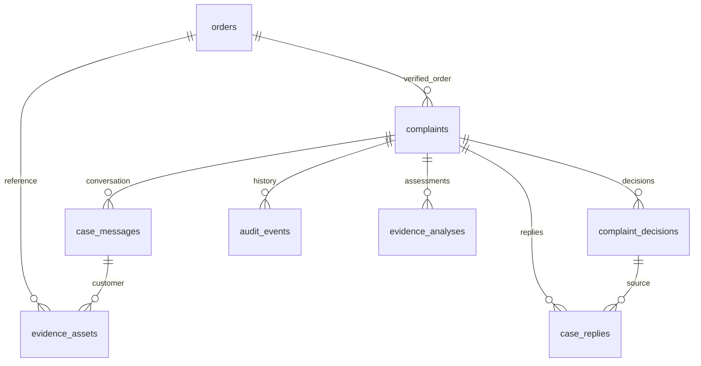

# Database design — TARGET v3 chốt trước triển khai

Mục tiêu: đủ cho vòng trao đổi, nhiều quyết định, gửi có xác nhận, ảnh và close; giảm sửa schema giữa ba nhánh. Đây là đặc tả, chưa áp dụng DB. A tổng hợp migration phát hành từ metadata ba domain; kiểm tra actual heads/current trước khi tạo migration mới, không sửa 0001–0004 đã áp dụng.

## CURRENT và tương thích

`orders` và `complaints` hiện có theo `backend/app/models.py`. Complaint giữ email đầu, extraction, verified_order FK, policy và case_status cũ; is_complaint NULL/false/true giữ ý nghĩa. Không đổi ID hoặc xóa cột cũ. Các cột projection cũ phục vụ client cũ; workflow mới dùng field riêng, không gán enum mới vào CHECK cũ.

## ERD đích

## Owner metadata và phát triển độc lập

- A: orders/complaints/core audit/messages/sessions/integration_state và Alembic aggregate; B: evidence tables + spec field assessment/order; C: decisions/replies/operations + spec field lifecycle core. B/C tự code model/DTO/router/service/UI của mình, không gửi mọi backend cho A viết.
- Root core fields được chốt trong BASE một lần, một metadata registry không import vòng. B/C có manifests/metadata declarations và factories để test trong schema riêng trước khi aggregate migration release xong.
- Shared CaseStore/UoW giữ row lock/version/audit và cho join transaction, không nested commit. B publish patches assessment/invalidate current decision; C patch decision/workflow/fulfillment/closed_at; A append inbound/outbound/canonical thread. Domain không sửa trực tiếp bảng bên khác. Chi tiết [SHARED_CONTRACTS](SHARED_CONTRACTS.md).
- Schema bảng/cột/constraint bên dưới giữ thiết kế nghiệp vụ đã chốt, không tạo DB mỗi người. Test metadata create_all chỉ schema thử; Cloud SQL release dùng một Alembic head/backfill.

## Kiểu chung và constraints

PK cũ int, PK bảng mới UUID; FK complaint_id int. Timestamp timestamptz UTC, JSON JSONB, text có giới hạn qua Pydantic, tiền Numeric(14,2) + >=0. Enum lưu varchar CHECK theo WORKFLOW, không native PostgreSQL enum. FK hồ sơ/evidence/decision không cascade xóa lịch sử. created_at server default now; immutable events không sửa/xóa qua API.

## Bảng/cột mới hoặc bổ sung

| Bảng | Field/type/null/default | Constraint/index |
|---|---|---|
| orders (thêm) | purchased_at date?, product_name varchar(200)?, total_amount Numeric(14,2)? | total_amount null hoặc >=0; không tự bịa số tiền cũ |
| complaints (thêm) | gmail_thread_id varchar(200)?, workflow_status varchar(32) NOT NULL needs_review, processing_status varchar(16) NOT NULL pending, ownership_status varchar(24) NOT NULL unverified, case_version int NOT NULL 1 | partial unique thread_id IS NOT NULL; version>=1; index(workflow_status,updated_at) |
| complaints (thêm) | current_decision_id UUID?, policy_version varchar(60)?, policy_snapshot JSONB NOT NULL {}, needs_manual_review bool NOT NULL false, fulfillment_status varchar(16) NOT NULL not_required, closed_at timestamptz? | FK current_decision_id tạo sau decision table; service bảo đảm cùng complaint; enums WORKFLOW |
| case_messages | id UUID PK, complaint_id FK, gmail_message_id varchar(200) NOT NULL, gmail_thread_id varchar(200)?, rfc_message_id text?, in_reply_to text?, references_header text?, direction varchar(10), sender_email varchar(320), recipient_email varchar(320), subject text, body text, occurred_at timestamptz, processing_status varchar(16), analysis JSONB NOT NULL {}, processing_error varchar(100)? | unique Gmail ID; direction inbound/outbound; index(complaint_id,occurred_at,id) |
| complaint_decisions | id UUID PK, complaint_id FK, action varchar(30), resolution varchar(40), note text, missing_fields JSONB NOT NULL [], actor varchar(100), basis_case_version int, assessment_snapshot JSONB NOT NULL {}, created_at | unique(complaint_id,basis_case_version); index(complaint_id,created_at); action-resolution rule WORKFLOW |
| case_replies | id UUID PK, complaint_id FK, decision_id FK, in_reply_to_message_id FK case_messages, recipient_email varchar(320), subject varchar(300), body text, status varchar(20) NOT NULL prepared, basis_case_version int, revision int NOT NULL 1, gmail_draft_id varchar(200)?, gmail_draft_content_hash varchar(64)?, accepted_external_hash varchar(64)?, gmail_sent_message_id varchar(200)?, outbound_rfc_message_id text NOT NULL, operation varchar(12)?, attempt_token UUID?, error_code varchar(100)?, sent_at timestamptz?, updated_at | unique decision_id (một reply/decision); unique nonnull sent ID; unique outbound_rfc_message_id; revision>=1; source FK phải cùng hồ sơ qua service validation |
| reply_operations | id UUID PK, reply_id FK, idempotency_key UUID NOT NULL, operation varchar(12), expected_revision int, request_hash varchar(64), status varchar(20), started_at, finished_at?, error_code? | unique idempotency_key; operation save_draft/send; một active operation/reply (partial unique khi status=in_progress) |
| audit_events | id UUID PK, complaint_id FK, event_type varchar(60), actor varchar(100), before_data JSONB NOT NULL {}, after_data JSONB NOT NULL {}, note text, created_at | index(complaint_id,created_at,id); event ghi cùng transaction business |
| evidence_assets | id UUID PK, order_id FK?, message_id FK?, source varchar(12), object_key text, content_type varchar(30), size_bytes int, sha256 varchar(64), created_at | source order/customer; XOR owner: order cần order_id, customer cần message_id inbound; unique object_key; unique owner+sha256 qua partial indexes; size 1..5242880 |
| evidence_analyses | id UUID PK, complaint_id FK, status varchar(16), mode varchar(16), asset_ids JSONB NOT NULL [], consistency varchar(20)?, observations JSONB NOT NULL [], limitations JSONB NOT NULL [], missing_evidence JSONB NOT NULL [], model varchar(100)?, error_code varchar(100)?, created_at, completed_at? | mode single_side/comparison; index(complaint_id,created_at); max một pending/hồ sơ |
| staff_sessions | id UUID PK, token_hash varchar(64), csrf_hash varchar(64), staff_id varchar(100), expires_at, revoked_at? | unique token_hash; index expires_at |
| integration_state | id int PK (luôn 1), last_attempt_at timestamptz?, last_success_at timestamptz?, last_error_code varchar(100)?, pending_thread_ids JSONB NOT NULL [], known_thread_cursor int NOT NULL 0, discovery_page_token text?, deferred_count int NOT NULL 0 | singleton CHECK id=1; cursor>=0; lưu lịch sử sync tối thiểu, không chứa OAuth token |

Dấu ? = nullable; còn lại NOT NULL. Các cột created_at/started_at có server default now, updated_at có server default và ORM update. Bảng snapshot không chứa key/token hoặc binary ảnh. UUID tạo tại app; actor là session username, job dùng system:scheduler/system:sync.

## Projection, snapshot và transaction

- policy_snapshot chứa result/reason/missing_fields/next_action/version và dữ liệu đơn ở thời điểm đánh giá. AI original nằm message.analysis; employee correction trong audit và complaint projection. Không ghi đè chứng cứ gốc.
- policy_snapshot có `data_source` ai/manual, `manual_overrides` object và `assessment_received_at` để retry biết field nào đã sửa tay và ngày tính policy. Đây là metadata nghiệp vụ được kiểm soát schema, không nơi chứa field tùy ý để né thiết kế bảng.
- Quyết định snapshot gồm policy, ownership, order fields, evidence analysis ID và phương án; current_decision_id là decision mới nhất, không khóa lần đầu.
- fulfillment pending khi approve; not_required cho reject/request_information. Fulfillment completed cần ghi nhận thao tác ngoài app trong audit; không lưu status thanh toán giả.
- Gmail draft hash lưu SHA256 của canonical UTF-8 JSON `{recipient_email,subject,body}` (sort_keys, separators comma/colon, normalize CRLF thành LF); so remote với hash lần đồng bộ trước, không so với body local vừa sửa. accepted_external_hash chỉ có hiệu lực cho đúng remote hash nhân viên đã xem, xóa sau lần save/send thành công. Không lấy hash này thay Gmail sent ID hoặc chứng minh đã gửi.
- Row lock complaint + kiểm tra case_version cho mọi mutation ngữ cảnh. Inbound unique + insert message + bump version/audit/mở lại là một transaction; network nằm ngoài.
- Reply reservation kiểm tra case version, reply revision, latest inbound, ownership và decision trước chuyển sending/draft_saving. Giữ operation row để idempotency; không giữ transaction qua Gmail call. Completion chỉ chuyển workflow nếu ngữ cảnh vẫn hiện hành, không đè needs_review do inbound mới.
- is_stale của reply chưa gửi được tính, không cột: khác basis version/current decision/latest inbound. Reply sent là lịch sử, is_stale=false, không sửa body hoặc gửi lại. Sau fulfillment làm version tăng không làm thư đã gửi trở thành lỗi; close kiểm latest decision/inbound và workflow resolved, không đòi basis version thư cũ bằng version sau fulfillment.
- DTO fields tính từ quan hệ, không cần migration thêm: decision_status từ current_decision.action (hoặc undecided), last_message_at từ MAX(case_messages.occurred_at), reply_status từ reply của current_decision. workflow_counts đếm canonical complaints is_complaint=true; technical_failed gồm candidate NULL và complaint true, không gồm false. CaseDetail.history sắp theo time rồi ID.

## Legacy mapping

case_status cũ phản ánh processing trước: pending/processing → processing; failed → processing_failed. Sau completed: closed/resolved → processed; waiting_customer → insufficient_information; các trường hợp còn lại → pending_review. API mới đọc workflow_status, không suy từ case_status. Stats cũ chỉ là projection, thêm counters workflow và technical_failed riêng.

## Migration/backfill một đợt có kiểm soát

1. Inspect heads/current; tạo các bảng mới và cột nullable/default, FK vòng current_decision thêm sau; không drop/rename field cũ.
2. Mỗi complaint cũ tạo một inbound case_message từ email đã lưu, cùng Gmail ID, processing ánh xạ. Giữ is_complaint; không tạo decision/reply/fulfillment đã hoàn tất giả.
3. Bản ghi cũ processed không đủ bằng chứng nghiệp vụ → workflow needs_review, không tự đóng. Tạo integration_state id=1.
4. thread_id cũ thiếu: để null; A bổ sung metadata Gmail. Nếu hai legacy row cùng thread, chọn row ID nhỏ nhất làm canonical, chuyển messages/related child sang canonical, lưu audit canonicalization; giữ row cũ với is_complaint=false/needs_manual_review=true, không xóa. Chỉ một canonical giữ thread unique. Client cũ có thể trả row cũ hidden; UI dùng canonical từ danh sách.
5. Chạy backfill lặp an toàn bằng unique Gmail ID; kiểm tra số messages/constraints và Alembic drift trên DB thử, rồi mới migrate cloud.

## Seed

CPDEMO001–005 và ca ngoại lệ, ngày tương đối theo DEMO_DATE=2026-11-14, email qua DEMO_CUSTOMER_EMAIL nhóm kiểm soát. Seed lặp không đổi đơn thật hoặc tạo mail/decision giả đã gửi. Ảnh giả upload Storage, metadata theo FK; không commit email khách thật. Không xây payment/customer/inventory/multi-tenant tables cho MVP.
