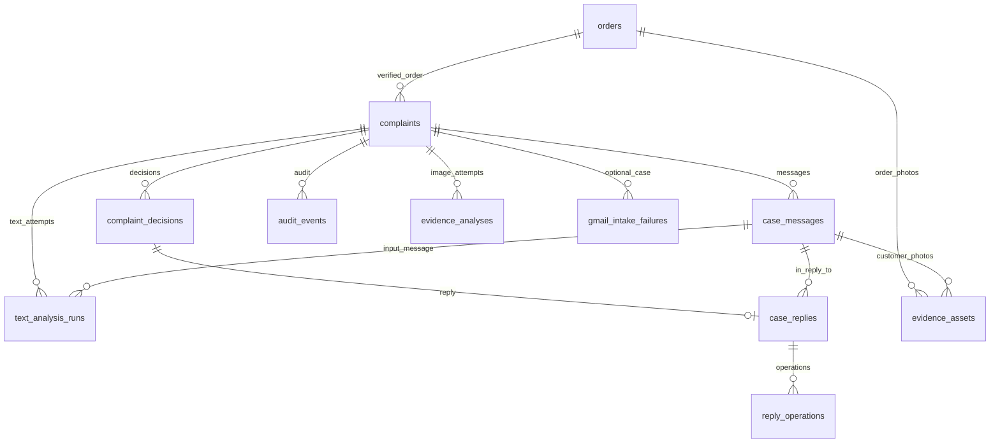

# Database Design — CLAIMPILOT_MVP_DB_V1

**Trạng thái: FROZEN_SPEC; đã triển khai local bằng migration0005 ngày14/11/2026.** Ngày chốt đặc tả13/11/2026. Models/schema_v1/backfill_v1 đã có; PostgreSQL17 local đủ13 bảng/203 cột, legacy data giữ nguyên. Cloud SQL và gate nghiệp vụ chưa nghiệm thu; xem IMPLEMENTATION_REPORT và phần11. PostgreSQL 17 trên Cloud SQL; SQLAlchemy 2 + Alembic. Đây là nguồn duy nhất về bảng/cột/type/default/constraint, áp dụng cho cả mốc 50%,80% và đầy đủ MVP.

## 1. Cam kết phạm vi và quy tắc khóa schema

- Chốt **13 bảng** cho một doanh nghiệp, một Gmail, một tài khoản staff cấu hình, một đơn được chọn mỗi hồ sơ. Không thêm payment/kho/multi-tenant/video hoặc công cụ split/merge.
- BASE phải dựng models/migration/fixture đúng toàn bộ schema này trước khi A/B/C code nghiệp vụ song song. Mốc50% chỉ dùng một phần bảng; mốc 80% bật thêm chức năng, không cần thêm bảng/cột cho các luồng đã chốt.
- A tổng hợp một migration chain và metadata registry; B/C ánh xạ model domain theo schema cố định. Sau BASE, ba người không tự ALTER TABLE, thêm/đổi cột/enum/index hoặc tạo migration head riêng. Key/model/provider AI thay qua config/Secrets, không qua schema.
- Lỗi implementation phải sửa code theo hợp đồng. Chỉ khi phát hiện yêu cầu mới hoặc thiết kế không đáp ứng một ca có bằng chứng mới được đề nghị đổi schema: mô tả ca, ảnh hưởng API/UI/backfill/tests, thống nhất cả nhóm rồi A tích hợp. Không hứa không bao giờ cần migration cho mọi mở rộng tương lai.
- Chỉ tài liệu được cập nhật trong đợt này; không coi FROZEN_SPEC là DB đã có bảng hoặc đã pass migration. [TASK](TASK.md), [SHARED_CONTRACTS](SHARED_CONTRACTS.md), [WORKFLOW](WORKFLOW.md), [API](API_SPECIFICATION.md) vẫn quy định nghiệp vụ/ownership/wire.

## 2. Danh mục 13 bảng và owner

| # | Bảng | Mục đích | Owner nghiệp vụ |
|---|---|---|---|
| 1 | orders | Đơn hàng mẫu để xác minh, ngày giao, giá trị | A giữ baseline; B dùng/xác minh |
| 2 | complaints | Hồ sơ hiện hành, projection AI/policy/lifecycle, version | Core A; B/C cập nhật qua CaseStore |
| 3 | case_messages | Các email inbound/outbound trong một hồ sơ | A; C append outbound qua cùng UoW |
| 4 | text_analysis_runs | Từng lần phân tích văn bản, gồm lỗi và kết quả đến muộn | B |
| 5 | complaint_decisions | Nhiều quyết định append-only, phương án và snapshot | C |
| 6 | case_replies | Nội dung phản hồi có revision, Gmail draft/sent state | C |
| 7 | reply_operations | Mỗi intent save_draft/send, idempotency và xác nhận gửi | C |
| 8 | audit_events | Thay đổi thủ công, quyết định, thực hiện, close/reopen | A primitive; domain ghi cùng transaction |
| 9 | evidence_assets | Metadata ảnh, owner, private GCS location/generation | B |
| 10 | evidence_analyses | Các lần Gemini đọc/đối chiếu ảnh và input snapshot | B |
| 11 | staff_sessions | Hash phiên/CSRF, hết hạn và revoke | A |
| 12 | integration_state | Mailbox binding, sync cursors/last_success/deferred | A |
| 13 | gmail_intake_failures | Email chưa fetch/parse được để retry, không tạo hồ sơ giả | A |

Hai bảng mới so với bản rút gọn trước là text_analysis_runs và gmail_intake_failures: giữ lịch sử AI và lỗi trước khi có hồ sơ, không phải thêm chức năng sản phẩm. Dữ liệu thực hiện ngoài app được chốt ở projection complaints + audit, không cần bảng payment/fulfillment engine riêng.

## 3. Quan hệ tổng thể



Staff sessions và integration_state độc lập, không tạo quan hệ người dùng/tenant giả. Current decision/latest text run/active operation là FK nullable tạo sau các bảng để xử lý vòng tham chiếu.

## 4. Quy ước kỹ thuật chung

- Trong dictionary: **N** = NOT NULL, **Y** = nullable. Default `—` = không server default; caller phải truyền nếu N. UUID mới sinh bằng uuid4 ở app, không cần extension; int PK cũ giữ sequence/identity hiện có.
- Tất cả thời điểm dùng TIMESTAMPTZ UTC. Ngày nghiệp vụ DATE theo Asia/Ho_Chi_Minh. created_at/started_at mặc định now(); updated_at mặc định now() và service cập nhật trong mọi mutation, không tự nhận có trigger nếu chưa tạo.
- Tiền NUMERIC(14,2), JSON trả string; currency chỉ VND trong MVP. Không float, không đoán total_amount thiếu.
- Enum lưu VARCHAR + CHECK, không PostgreSQL native ENUM; tập giá trị cố định tại phần5. Provider/model là string không CHECK theo tên model để đổi API mà không đổi DB; app vẫn validate adapter hỗ trợ.
- JSONB chỉ chứa cấu trúc đã định nghĩa ở phần7, có CHECK jsonb_typeof, Pydantic validate keys/elements/limits. Không dùng JSONB làm chỗ thêm field nghiệp vụ tùy ý để lách freeze.
- FK mặc định ON DELETE NO ACTION, không cascade xóa hồ sơ/lịch sử/ảnh. Không có API DELETE lịch sử; app role không được UPDATE/DELETE audit_events hoặc UPDATE/DELETE decisions. Trạng thái operation/analysis được cập nhật để hoàn tất attempt, không sửa kết quả đã kết thúc.
- PK/unique đã tạo index thì không tạo index trùng. Đặt tên rõ: pk_<table>, fk_<table>_<purpose>, uq_<table>_<purpose>, ck_<table>_<purpose>, ix_<table>_<purpose>; giữ tên constraint legacy khi đã áp dụng, không rename chỉ vì style.
- Email lưu dạng đã parse/trim, so khớp theo casefold trong service. Không UNIQUE email khách hàng. Không CHECK định dạng email bằng regex đơn giản thay thư viện validation. Thư parse không ra sender vào intake_failures, không bịa customer.
- Không thêm CHECK ngày giao nhất quán trên orders: dữ liệu thực có thể thiếu/bất nhất cần được policy giải thích, không làm intake crash. Không dùng CHECK cho điều kiện cần đọc bảng khác.

## 5. Enum cố định

| Field | Giá trị |
|---|---|
| complaints.workflow_status | needs_review, waiting_customer, waiting_fulfillment, resolved, closed |
| processing_status (case/message) | pending, processing, completed, failed |
| ownership_status | unverified, email_matched, manually_verified, mismatch |
| complaint_type nullable | late_delivery, not_received, damaged_item, wrong_item, refund_request, other |
| requested_action nullable | shipping_fee_refund, order_refund, replacement, request_information, other |
| priority nullable | low, medium, high |
| policy_result nullable | eligible_for_review, not_eligible, insufficient_information, order_not_found, not_applicable |
| case_status legacy | processing, pending_review, insufficient_information, processing_failed, processed |
| direction | inbound, outbound |
| text_analysis_runs.status | processing, completed, failed, stale |
| decision.action | approve, reject, request_information |
| decision.resolution | shipping_fee_refund, order_refund, replacement, reshipment, carrier_investigation, decline, request_information, other |
| fulfillment_status | not_required, pending, completed |
| case_replies.status | prepared, draft_saving, draft_saved, sending, sent, failed, unknown |
| reply_operations.operation / case_replies.operation | save_draft, send (reply.operation nullable) |
| reply_operations.status | in_progress, succeeded, failed, unknown |
| evidence_assets.source | order, customer |
| evidence_assets.evidence_kind | packing, delivery, customer |
| evidence_assets.content_type | image/jpeg, image/png |
| evidence_analyses.status | pending, completed, failed |
| evidence_analyses.mode | single_side, comparison |
| evidence_analyses.consistency nullable | consistent, inconsistent, inconclusive |
| gmail_intake_failures.status | pending, resolved, ignored |

verification_status legacy không CHECK enum mới vì đang có các mã not_checked/missing_order_id/order_not_found/not_delivered/insufficient_data/delivered; API tiếp tục dùng mã có chủ đích. Actor lưu staff username hoặc system:sync/system:scheduler/system:reconcile/system:backfill, không nhận tùy ý từ client.

## 6. Dictionary — đủ cột cho baseline

Những cột legacy được giữ tên/nullability; riêng complaints.processing_error được mở rộng VARCHAR(80) thành VARCHAR(100), không cắt dữ liệu. Server defaults mới chỉ áp dụng qua migration additive có kiểm tra backfill. Bảng mới không có dữ liệu thật trước migration. Metadata thực thi: backend/app/schema_v1.py; ORM: models.py; migration0005 nối0004. Snapshot/backfill_v1 là dependency migration đã áp dụng: không sửa; cần thay đổi phải qua change-control và revision mới.

### 6.1. `orders`

| Cột | Type PostgreSQL | NULL? | Default | Ý nghĩa |
|---|---|---|---|---|
| id | INTEGER | N | sequence/identity cũ | PK; giữ ID cũ |
| order_id | VARCHAR(100) | N | — | Mã nghiệp vụ UNIQUE |
| customer_email | VARCHAR(320) | N | — | Email chủ đơn |
| order_status | VARCHAR(40) | N | — | Giữ trạng thái nguồn; service normalize Delivered/In Transit |
| expected_delivery_date | DATE | Y | — | Ngày dự kiến |
| actual_delivery_date | DATE | Y | — | Ngày giao thực tế |
| shipping_fee | NUMERIC(14,2) | N | — | >=0 |
| created_at | TIMESTAMPTZ | N | now() | Thời điểm tạo |
| purchased_at | DATE | Y | — | Ngày mua, không bịa backfill |
| product_name | VARCHAR(200) | Y | — | Tên sản phẩm mẫu |
| total_amount | NUMERIC(14,2) | Y | — | Null hoặc >=0 |
| currency | CHAR(3) | N | 'VND' | CHECK VND; không đa tiền tệ |

### 6.2. `complaints`

| Cột | Type PostgreSQL | NULL? | Default | Ý nghĩa |
|---|---|---|---|---|
| id | INTEGER | N | sequence/identity cũ | PK hồ sơ |
| gmail_message_id | VARCHAR(200) | N | — | Gmail ID email đầu, UNIQUE legacy |
| sender_email | VARCHAR(320) | N | — | Correspondent gốc; không tự đổi theo reply từ người khác |
| email_subject | TEXT | N | — | Subject email đầu, giữ nguyên |
| email_body | TEXT | N | — | Body email đầu, giữ nguyên |
| received_at | TIMESTAMPTZ | N | — | Ngày nhận email đầu |
| is_complaint | BOOLEAN | Y | NULL | NULL chưa phân loại, false không liên quan, true complaint |
| complaint_type | VARCHAR(40) | Y | — | Projection hiện hành |
| order_id | VARCHAR(100) | Y | — | Mã đơn trích xuất/đã đính chính |
| verified_order_id | INTEGER | Y | — | FK orders.id |
| requested_action | VARCHAR(40) | Y | — | Mong muốn khách, khác resolution |
| ai_summary | TEXT | Y | — | Projection tóm tắt |
| missing_information | JSONB | N | '[]'::jsonb | Array strings; giữ field legacy |
| priority | VARCHAR(10) | Y | — | CHECK enum hoặc NULL |
| verification_status | VARCHAR(40) | N | 'not_checked' | Mã xác minh legacy |
| sender_matches_order | BOOLEAN | Y | — | Tín hiệu đối chiếu email |
| policy_result | VARCHAR(40) | Y | — | Projection result |
| policy_reason | TEXT | Y | — | Giải thích |
| case_status | VARCHAR(40) | N | 'processing' | Projection tương thích client cũ |
| processing_error | VARCHAR(100) | Y | — | Mở rộng từ 80 để đồng bộ mã lỗi; không stacktrace |
| created_at | TIMESTAMPTZ | N | now() | Legacy |
| updated_at | TIMESTAMPTZ | N | now() | Service cập nhật |
| canonical_case_id | INTEGER | Y | — | Self FK cho legacy alias; canonical row NULL |
| gmail_thread_id | VARCHAR(200) | Y | — | Thread, thiếu metadata cũ cho phép NULL |
| workflow_status | VARCHAR(32) | N | 'needs_review' | Trạng thái nghiệp vụ |
| processing_status | VARCHAR(16) | N | 'pending' | Trạng thái phân tích riêng |
| ownership_status | VARCHAR(24) | N | 'unverified' | Xác minh chủ đơn |
| case_version | INTEGER | N | 1 | >=1, optimistic context |
| current_decision_id | UUID | Y | — | FK composite cùng case, tạo sau |
| latest_text_analysis_id | UUID | Y | — | FK composite tới run đã apply |
| policy_version | VARCHAR(60) | Y | — | Ví dụ demo-v2 |
| policy_snapshot | JSONB | N | '{}'::jsonb | Object theo phần7 |
| needs_manual_review | BOOLEAN | N | false | Nhiều đơn/người gửi/ngoại lệ |
| fulfillment_status | VARCHAR(16) | N | 'not_required' | Thực hiện ngoài app |
| fulfillment_completed_at | TIMESTAMPTZ | Y | — | Khi staff ghi hoàn tất |
| fulfillment_completed_by | VARCHAR(100) | Y | — | Staff actor |
| fulfillment_reference | VARCHAR(200) | Y | — | Mã tham chiếu ngoài app, không tự fetch |
| fulfillment_note | VARCHAR(2000) | Y | — | Ghi chú thực hiện |
| resolved_at | TIMESTAMPTZ | Y | — | Đã giải quyết |
| closed_at | TIMESTAMPTZ | Y | — | Đã đóng |
| closed_by | VARCHAR(100) | Y | — | Staff đóng |
| close_note | VARCHAR(2000) | Y | — | Lý do đóng |

### 6.3. `case_messages`

| Cột | Type PostgreSQL | NULL? | Default | Ý nghĩa |
|---|---|---|---|---|
| id | UUID | N | app uuid4 | PK |
| complaint_id | INTEGER | N | — | FK complaints.id canonical |
| gmail_message_id | VARCHAR(200) | N | — | UNIQUE, inbound/outbound cùng namespace mailbox |
| gmail_thread_id | VARCHAR(200) | Y | — | Legacy thiếu header được NULL |
| rfc_message_id | TEXT | Y | — | Message-ID header, không UNIQUE |
| in_reply_to | TEXT | Y | — | Header gốc |
| references_header | TEXT | Y | — | References gốc |
| direction | VARCHAR(10) | N | — | inbound/outbound |
| sender_email | VARCHAR(320) | N | — | From đã parse |
| recipient_email | VARCHAR(320) | Y | — | NULL chỉ inbound/legacy chưa có To; outbound bắt buộc |
| subject | TEXT | N | — | Subject message |
| body | TEXT | N | — | Text, không HTML thực thi |
| occurred_at | TIMESTAMPTZ | N | — | Thời điểm Gmail nhận/gửi |
| processing_status | VARCHAR(16) | N | 'pending' | Outbound completed, không phân loại lại thành complaint |
| analysis | JSONB | N | '{}'::jsonb | Raw AI thành công gần nhất đã apply, không manual override; runs giữ mọi attempt |
| processing_error | VARCHAR(100) | Y | — | Lỗi gần nhất |
| created_at | TIMESTAMPTZ | N | now() | Thời điểm ingest |

### 6.4. `text_analysis_runs`

| Cột | Type PostgreSQL | NULL? | Default | Ý nghĩa |
|---|---|---|---|---|
| id | UUID | N | app uuid4 | PK |
| complaint_id | INTEGER | N | — | FK complaints canonical |
| message_id | UUID | N | — | FK composite message cùng case |
| basis_case_version | INTEGER | N | — | >=1, context lúc bắt đầu |
| applied_case_version | INTEGER | Y | — | Version sau publish; NULL nếu failed/stale |
| provider | VARCHAR(60) | N | — | Tên adapter, không CHECK tên hãng |
| model | VARCHAR(200) | Y | — | NULL nếu lỗi trước resolve model |
| status | VARCHAR(16) | N | 'processing' | processing/completed/failed/stale |
| input_hash | CHAR(64) | N | — | SHA256 input refs/context chuẩn hóa |
| input_snapshot | JSONB | N | '{}'::jsonb | Refs/version/manual overrides, không token/prompt secret |
| output | JSONB | Y | — | Validated raw Analysis object, kể cả kết quả stale |
| error_code | VARCHAR(100) | Y | — | Bắt buộc khi failed |
| started_at | TIMESTAMPTZ | N | now() | Attempt bắt đầu |
| finished_at | TIMESTAMPTZ | Y | — | Attempt kết thúc |

### 6.5. `complaint_decisions`

| Cột | Type PostgreSQL | NULL? | Default | Ý nghĩa |
|---|---|---|---|---|
| id | UUID | N | app uuid4 | PK |
| complaint_id | INTEGER | N | — | FK complaints |
| action | VARCHAR(30) | N | — | approve/reject/request_information |
| resolution | VARCHAR(40) | N | — | Phương án theo action |
| note | VARCHAR(2000) | N | — | Trim 1..2000 |
| missing_fields | JSONB | N | '[]'::jsonb | Array 0..20; request_information cần 1..20 |
| actor | VARCHAR(100) | N | — | Staff từ session |
| basis_case_version | INTEGER | N | — | Version trước append decision, >=1 |
| assessment_snapshot | JSONB | N | '{}'::jsonb | Order/policy/ownership/evidence/inputs tại quyết định |
| proposed_amount | NUMERIC(14,2) | Y | — | Chỉ refund đề xuất; NULL nếu chưa đủ dữ liệu, không giao dịch |
| currency | CHAR(3) | N | 'VND' | CHECK VND |
| created_at | TIMESTAMPTZ | N | now() | Append-only |

### 6.6. `case_replies`

| Cột | Type PostgreSQL | NULL? | Default | Ý nghĩa |
|---|---|---|---|---|
| id | UUID | N | app uuid4 | PK |
| complaint_id | INTEGER | N | — | FK complaints |
| decision_id | UUID | N | — | UNIQUE, FK composite decision cùng case |
| in_reply_to_message_id | UUID | N | — | FK composite message inbound cùng case |
| recipient_email | VARCHAR(320) | N | — | From correspondent gốc, server derive |
| subject | VARCHAR(300) | N | — | 1..300, không CR/LF |
| body | TEXT | N | '' | 0..10000; empty chỉ prepared manual, gửi cần1..10000 |
| status | VARCHAR(20) | N | 'prepared' | CHECK reply enum |
| basis_case_version | INTEGER | N | — | >=1 |
| revision | INTEGER | N | 1 | >=1, edit/review_context tăng |
| gmail_draft_id | VARCHAR(200) | Y | — | Draft ID từ Gmail |
| gmail_draft_content_hash | CHAR(64) | Y | — | Hash remote đã đồng bộ |
| accepted_external_hash | CHAR(64) | Y | — | Hash remote staff đã cho phép ghi đè |
| gmail_sent_message_id | VARCHAR(200) | Y | — | UNIQUE khi có |
| sent_message_id | UUID | Y | — | FK composite outbound message cùng case |
| outbound_rfc_message_id | TEXT | N | — | UNIQUE, server tạo ổn định theo reply UUID |
| operation | VARCHAR(12) | Y | — | save_draft/send; intent đang/gần nhất |
| attempt_token | UUID | Y | — | FK composite operation ID của chính reply, tạo sau |
| error_code | VARCHAR(100) | Y | — | Mã lỗi gần nhất |
| sent_at | TIMESTAMPTZ | Y | — | Chỉ có khi sent đã persist |
| created_at | TIMESTAMPTZ | N | now() | Tạo reply |
| updated_at | TIMESTAMPTZ | N | now() | Service update |

### 6.7. `reply_operations`

| Cột | Type PostgreSQL | NULL? | Default | Ý nghĩa |
|---|---|---|---|---|
| id | UUID | N | app uuid4 | PK, cũng là reply.attempt_token |
| reply_id | UUID | N | — | FK case_replies |
| idempotency_key | UUID | N | — | UNIQUE toàn app |
| operation | VARCHAR(12) | N | — | save_draft/send |
| expected_case_version | INTEGER | N | — | >=1, đã kiểm reserve |
| expected_revision | INTEGER | N | — | >=1, nội dung staff đã xem |
| request_hash | CHAR(64) | N | — | Hash request/intent chuẩn hóa |
| request_snapshot | JSONB | N | '{}'::jsonb | Payload bất biến: recipient/subject/body/version/decision/confirmed |
| result_snapshot | JSONB | N | '{}'::jsonb | Kết quả đã persist cho replay, không credentials |
| actor | VARCHAR(100) | N | — | Staff requester |
| confirmed_at | TIMESTAMPTZ | Y | — | send cần có; draft có thể NULL |
| confirmed_by | VARCHAR(100) | Y | — | send cần actor từ phiên |
| status | VARCHAR(20) | N | 'in_progress' | in_progress/succeeded/failed/unknown |
| error_code | VARCHAR(100) | Y | — | Mã lỗi |
| started_at | TIMESTAMPTZ | N | now() | Reserve |
| finished_at | TIMESTAMPTZ | Y | — | Kết thúc call hoặc chuyển unknown |

### 6.8. `audit_events`

| Cột | Type PostgreSQL | NULL? | Default | Ý nghĩa |
|---|---|---|---|---|
| id | UUID | N | app uuid4 | PK |
| complaint_id | INTEGER | N | — | FK complaints canonical |
| event_type | VARCHAR(60) | N | — | Mã event phần7, không SQL enum cứng |
| actor | VARCHAR(100) | N | — | Staff/system actor |
| before_data | JSONB | N | '{}'::jsonb | Snapshot đã lọc |
| after_data | JSONB | N | '{}'::jsonb | Snapshot đã lọc |
| note | VARCHAR(2000) | N | '' | Nhân viên mutation yêu cầu note; system có thể rỗng |
| created_at | TIMESTAMPTZ | N | now() | Append-only, stable sort ID |

### 6.9. `evidence_assets`

| Cột | Type PostgreSQL | NULL? | Default | Ý nghĩa |
|---|---|---|---|---|
| id | UUID | N | app uuid4 | PK |
| order_id | INTEGER | Y | — | FK orders, chỉ source order |
| message_id | UUID | Y | — | FK case_messages, chỉ source customer/inbound |
| source | VARCHAR(12) | N | — | order/customer |
| evidence_kind | VARCHAR(20) | N | — | packing/delivery cho ảnh đơn; customer cho ảnh khách |
| bucket_name | VARCHAR(222) | N | — | Private bucket từ config lúc upload |
| object_key | VARCHAR(1024) | N | — | Object path server sinh, không URL khách |
| object_generation | BIGINT | N | — | >0, generation immutable từ GCS |
| content_type | VARCHAR(30) | N | — | JPEG/PNG decode thật |
| size_bytes | INTEGER | N | — | 1..5242880 |
| width_px | INTEGER | N | — | >0 |
| height_px | INTEGER | N | — | >0; width*height<=20000000 |
| sha256 | CHAR(64) | N | — | Digest bytes |
| created_at | TIMESTAMPTZ | N | now() | Persist sau upload/decode hợp lệ |

### 6.10. `evidence_analyses`

| Cột | Type PostgreSQL | NULL? | Default | Ý nghĩa |
|---|---|---|---|---|
| id | UUID | N | app uuid4 | PK |
| complaint_id | INTEGER | N | — | FK complaints |
| basis_case_version | INTEGER | N | — | >=1, snapshot trước call |
| applied_case_version | INTEGER | Y | — | Version sau publish hoặc NULL nếu context đổi |
| status | VARCHAR(16) | N | 'pending' | pending/completed/failed |
| mode | VARCHAR(16) | N | — | single_side/comparison |
| asset_ids | JSONB | N | '[]'::jsonb | UUID strings 1..4, service validate chủ sở hữu |
| provider | VARCHAR(60) | N | 'gemini' | Adapter hình ảnh, đổi config không đổi schema |
| model | VARCHAR(200) | Y | — | Model thực tế |
| consistency | VARCHAR(20) | Y | — | Single-side completed bắt buộc inconclusive |
| observations | JSONB | N | '[]'::jsonb | Array strings |
| limitations | JSONB | N | '[]'::jsonb | Array strings |
| missing_evidence | JSONB | N | '[]'::jsonb | Array strings |
| error_code | VARCHAR(100) | Y | — | Mã lỗi |
| created_at | TIMESTAMPTZ | N | now() | Bắt đầu pending |
| completed_at | TIMESTAMPTZ | Y | — | Kết thúc cả completed/failed |

### 6.11. `staff_sessions`

| Cột | Type PostgreSQL | NULL? | Default | Ý nghĩa |
|---|---|---|---|---|
| id | UUID | N | app uuid4 | PK |
| token_hash | CHAR(64) | N | — | UNIQUE SHA256, không token gốc |
| csrf_hash | CHAR(64) | N | — | SHA256 CSRF token |
| staff_id | VARCHAR(100) | N | — | Username cấu hình, không user FK giả |
| created_at | TIMESTAMPTZ | N | now() | Cấp phiên |
| expires_at | TIMESTAMPTZ | N | — | >created_at, TTL8h tại service |
| revoked_at | TIMESTAMPTZ | Y | — | Logout/revoke |

### 6.12. `integration_state`

| Cột | Type PostgreSQL | NULL? | Default | Ý nghĩa |
|---|---|---|---|---|
| id | INTEGER | N | — | PK CHECK id=1 |
| mailbox_email | VARCHAR(320) | Y | — | NULL trước consent; bind một Gmail, không tự đổi account |
| last_attempt_at | TIMESTAMPTZ | Y | — | Lần sync gần nhất bắt đầu |
| last_success_at | TIMESTAMPTZ | Y | — | Batch bounded thành công gần nhất |
| last_error_code | VARCHAR(100) | Y | — | Lỗi mới nhất, không xóa timestamp thành công cũ |
| last_duration_ms | INTEGER | Y | — | NULL hoặc >=0 |
| pending_thread_ids | JSONB | N | '[]'::jsonb | Array Gmail thread ID strings, không UUID nội bộ |
| known_thread_cursor | INTEGER | N | 0 | >=0, last canonical case ID đã quét |
| discovery_page_token | TEXT | Y | — | Pagination token không phải OAuth token |
| deferred_count | INTEGER | N | 0 | >=0 |
| last_sync_summary | JSONB | N | '{}'::jsonb | Counts bounded, không body/token |
| updated_at | TIMESTAMPTZ | N | now() | Service update |

### 6.13. `gmail_intake_failures`

| Cột | Type PostgreSQL | NULL? | Default | Ý nghĩa |
|---|---|---|---|---|
| gmail_message_id | VARCHAR(200) | N | — | PK, đã biết Gmail ID nhưng fetch/parse lỗi |
| gmail_thread_id | VARCHAR(200) | Y | — | Nếu đã lấy được metadata |
| complaint_id | INTEGER | Y | — | FK complaints khi thread đã biết case |
| error_code | VARCHAR(100) | N | — | Mã sanitized, không raw MIME/exception |
| status | VARCHAR(12) | N | 'pending' | pending/resolved/ignored |
| attempt_count | INTEGER | N | 1 | >=1 |
| first_seen_at | TIMESTAMPTZ | N | now() | Lần đầu |
| last_attempt_at | TIMESTAMPTZ | N | now() | Lần thử mới nhất |
| resolved_at | TIMESTAMPTZ | Y | — | Kết thúc resolved/ignored |
| resolved_by | VARCHAR(100) | Y | — | Staff hoặc system actor kết thúc retry |
| resolution_note | VARCHAR(2000) | Y | — | Căn cứ ignore thủ công hoặc kết quả recovery |

## 7. Cấu trúc JSONB chốt trước, không thêm field tùy ý

Các field sau CHECK loại JSONB ở SQL; Pydantic kiểm tra schema version/keys/types/limits. UUID/date/Decimal trong JSON được encode thành string, không float. JSON không có FK tự động; service phải kiểm tra các ID snapshot trước khi ghi. Snapshot lịch sử được phép chứa dữ liệu cũ, không tự cập nhật theo projection hiện tại.

| Field | Cấu trúc/giới hạn cố định |
|---|---|
| complaints.missing_information | string[], tối đa 30 mục, từng mục 1..500 ký tự |
| case_messages.analysis / text_analysis_runs.output | Raw Analysis đã validate: is_complaint, complaint_type, order_id nullable, requested_action, summary1..4000, missing_information tối đa30strings, priority; output run có thể NULL trước kết quả, analysis message mặc định{} |
| complaints.policy_snapshot | schema_version=1; data_source ai/manual; assessment_received_at UTC string; order_snapshot object; policy_version/result/reason; missing_fields string[]; next_action string; manual_overrides object; ownership_confirmation object hoặc null; text_analysis_id UUID hoặc null; evidence_analysis_id UUID hoặc null |
| policy_snapshot.manual_overrides | Chỉ các key nhân viên thực sự sửa: is_complaint/order_id/complaint_type/requested_action; không actor/policy_result do client đặt. Giá trị mới là nguồn current, giá trị trước nằm audit |
| policy_snapshot.ownership_confirmation | actor/reason/confirmed_at/order_internal_id/correspondent. Reset khi đổi đơn; không nhận actor/time từ client |
| policy_snapshot.order_snapshot | id/order_id/product_name/order_status/purchased_at/expected_delivery_date/actual_delivery_date/customer_email/shipping_fee/total_amount/currency; fields thiếu giữ null, dữ liệu nội bộ không tự đưa vào thư cho người chưa xác minh |
| text_analysis_runs.input_snapshot | schema_version=1; source live/legacy; message_ids UUID[] theo thứ tự; basis_case_version; manual_overrides; order_internal_id nullable; truncated bool. Không token/system prompt secret. Live input_hash hash nội dung/context thực sự gửi; legacy hash dữ liệu còn lưu, không giả đã biết prompt cũ |
| complaint_decisions.assessment_snapshot | schema_version=1; case_version; latest_inbound_message_id; order_snapshot; policy_snapshot; ownership_status; evidence_analysis_id nullable; previous_decision_id nullable; previous_fulfillment object; resolution/proposed_amount/currency. Immutable sau insert |
| complaint_decisions.missing_fields | string[], tối đa 20 mục, từng mục 1..200; request_information cần ít nhất 1 mục; approve/reject dùng[] |
| reply_operations.request_snapshot | schema_version=1; complaint_id/reply_id/decision_id/latest_inbound_message_id; expected_case_version/expected_revision; recipient_email/subject/body; operation; confirmed bool. Copy bất biến tại reserve, không credentials |
| reply_operations.result_snapshot | schema_version=1; status; error_code nullable; gmail_draft_id/gmail_sent_message_id nullable; reply_revision; case_version. Replay trả kết quả đã lưu; client có thể GET reply để xem state hiện tại |
| audit_events.before_data / after_data | Object whitelist theo event: core field changes, IDs, version, manual corrections, fulfillment values hoặc reply/body revision khi cần. Không password/cookie/token/raw MIME/binary. actor/time nằm cột riêng |
| evidence_analyses.asset_ids | UUID string[] không trùng,1..4ảnh khi tạo pending; tối đa2mỗi source. Kiểm asset thuộc current order/customer messages đúng case; không FK cho UUID nằm trong JSON |
| evidence_analyses.observations / limitations / missing_evidence | string[] tối đa 30 mục mỗi field,1..1000ký tự/mục; empty khi pending/failed chưa có kết quả, không bịa observations |
| integration_state.pending_thread_ids | Gmail thread ID string[] dedupe; không UUID DB. Giới hạn batch theo architecture; backlog lớn xử lý tiếp, không bỏ vì cắt array |
| integration_state.last_sync_summary | successful/skipped/failed/deferred/messages_added/cases_created/cases_reopened là integer>=0; không email body hoặc token |

Audit event_type MVP: message_ingested, case_reopened, manual_reviewed, ownership_verified, assessment_applied, assessment_stale, decision_recorded, reply_prepared, reply_edited, reply_context_reviewed, reply_reserved, reply_draft_saved, reply_sent, reply_failed, reply_unknown, reply_reconciled, fulfillment_recorded, case_closed, legacy_canonicalized. Thêm tên event ứng dụng không đòi ALTER vì cột không dùng SQL enum; thêm field snapshot phải cập nhật Pydantic và tài liệu, không lách thay đổi bảng qua JSON.

## 8. Ràng buộc SQL và index bắt buộc

### 8.1. Khóa và FK cùng hồ sơ

PK như dictionary. FK child.complaint_id → complaints.id; complaints.verified_order_id/evidence_assets.order_id → orders.id; evidence_assets.message_id → case_messages.id; gmail_intake_failures.complaint_id nullable → complaints.id. canonical_case_id là self FK, CHECK null hoặc khác id; service chỉ trỏ một bước tới canonical row, không tạo vòng/chuỗi.

Tạo thêm các UNIQUE để FK composite bảo vệ **đúng hồ sơ**, không chỉ ID tồn tại:

| Bảng đích | UNIQUE tham chiếu |
|---|---|
| case_messages | (id,complaint_id) |
| text_analysis_runs | (id,complaint_id) |
| complaint_decisions | (id,complaint_id) |
| reply_operations | (id,reply_id) |

```sql
-- Các fragment định nghĩa ràng buộc, KHÔNG phải script upgrade chạy trực tiếp.
-- Những cột id,complaint_id/reply_id đích đã có UNIQUE như bảng trên.
FOREIGN KEY (message_id, complaint_id)
  REFERENCES case_messages (id, complaint_id);
-- Áp dụng ở text_analysis_runs.

FOREIGN KEY (decision_id, complaint_id)
  REFERENCES complaint_decisions (id, complaint_id);
FOREIGN KEY (in_reply_to_message_id, complaint_id)
  REFERENCES case_messages (id, complaint_id);
FOREIGN KEY (sent_message_id, complaint_id)
  REFERENCES case_messages (id, complaint_id);
-- Ba FK trên áp dụng ở case_replies.

FOREIGN KEY (current_decision_id, id)
  REFERENCES complaint_decisions (id, complaint_id)
  DEFERRABLE INITIALLY DEFERRED;
FOREIGN KEY (latest_text_analysis_id, id)
  REFERENCES text_analysis_runs (id, complaint_id)
  DEFERRABLE INITIALLY DEFERRED;
-- Hai FK vòng trên áp dụng ở complaints, thêm sau khi có bảng con.

FOREIGN KEY (attempt_token, id)
  REFERENCES reply_operations (id, reply_id)
  DEFERRABLE INITIALLY DEFERRED;
-- FK vòng trên áp dụng ở case_replies; operation.reply_id FK lại reply.id.
```

SQLAlchemy phải dùng ForeignKeyConstraint cho cặp cột, không hai ForeignKey rời. Không thêm CASCADE/SET NULL làm mất audit hoặc đổi dữ liệu khi xóa. FK mặc định MATCH SIMPLE cho pointer nullable; service kiểm tra case canonical và hướng inbound/outbound. CHECK không thể thay các kiểm tra cần đọc bảng khác.

### 8.2. Unique và partial unique

| Constraint/index | Định nghĩa |
|---|---|
| orders business key | UNIQUE(order_id), giữ legacy |
| complaints anchor | UNIQUE(gmail_message_id), giữ legacy |
| uq_complaints_canonical_thread | UNIQUE(gmail_thread_id) WHERE gmail_thread_id IS NOT NULL AND canonical_case_id IS NULL |
| case_messages Gmail key | UNIQUE(gmail_message_id); RFC Message-ID không unique vì dữ liệu ngoài có thể lặp |
| uq_decisions_basis | UNIQUE(complaint_id,basis_case_version), chống hai quyết định từ cùng version |
| case_replies business key | UNIQUE(decision_id), UNIQUE(outbound_rfc_message_id), UNIQUE(gmail_sent_message_id) với NULL được phép |
| reply_operations business key | UNIQUE(idempotency_key); cùng key không được reuse cho intent/payload khác |
| uq_reply_operations_unsettled | UNIQUE(reply_id) WHERE status IN ('in_progress','unknown'); unknown chưa đối soát vẫn khóa dispatch mới |
| uq_text_runs_active | UNIQUE(message_id) WHERE status='processing'; recover interrupted run trước retry |
| uq_evidence_pending | UNIQUE(complaint_id) WHERE status='pending' |
| uq_assets_location | UNIQUE(bucket_name,object_key,object_generation); generation cũ giữ để trace, không ghi đè bằng ảnh mới |
| uq_assets_order_hash | UNIQUE(order_id,evidence_kind,sha256) WHERE source='order' |
| uq_assets_customer_hash | UNIQUE(message_id,sha256) WHERE source='customer'; không dedupe ảnh khách giữa hai email khác làm mất nguồn |
| staff_sessions token | UNIQUE(token_hash) |
| integration_state singleton | PRIMARY KEY(id) + CHECK(id=1) |
| gmail_intake_failures Gmail key | PRIMARY KEY(gmail_message_id), UPSERT tăng attempt_count, không tạo nhiều row cho một email lỗi |

Partial unique không dùng làm đích FK. Khi backfill phải xử lý dữ liệu trùng trước validate unique. Giữ index legacy nếu vẫn dùng; không drop để tối ưu trong hackathon khi chưa có đo đạc.

### 8.3. CHECK bổ sung ngoài enum

- orders: shipping_fee>=0, total_amount null hoặc>=0, currency='VND'. order_status không SQL enum cứng để giữ dữ liệu nguồn.
- complaints: case_version>=1; missing_information array, policy_snapshot object. workflow_status=closed cần closed_at/closed_by/close_note không rỗng và resolved_at; ngoài closed các closed fields NULL. resolved/closed cần resolved_at; các workflow khác resolved_at NULL. fulfillment completed cần completed_at/by/note; pending/not_required thì các completion/reference/note fields NULL. Fulfillment completed vẫn có thể thuộc case needs_review sau inbound mới, không đảo việc đã thực hiện. Không CHECK chéo current_decision.action bằng subquery; CaseStore đảm bảo rule.
- case_messages: direction/processing enum; analysis object. Outbound cần recipient_email không rỗng và processing_status=completed. Inbound recipient_email được NULL nếu legacy thiếu metadata.
- text_analysis_runs: basis_case_version>=1; applied_case_version null hoặc>=basis_case_version; input_snapshot object; output null hoặc object; completed/stale phải có validated output và finished_at; failed phải có error_code/finished_at; processing chưa finished_at; failed/stale không có applied_case_version. completed có applied_case_version. finished_at null hoặc>=started_at.
- decisions: note trim1..2000; missing_fields array<=20. request_information cần resolution=request_information và array1..20; reject cần resolution=decline/[]; approve dùng resolution theo WORKFLOW/[]; currency VND. proposed_amount null hoặc>=0 và chỉ dùng action approve + resolution shipping_fee_refund/order_refund. Service xác minh số tiền đề xuất từ DB, không SQL CHECK chéo orders.
- replies: revision/basis>=1; subject1..300 không CR/LF; body0..10000. sent cần gmail_sent_message_id/sent_message_id/sent_at đủ; khi chưa sent ba cột này phải NULL. draft_saved cần gmail_draft_id. sending/draft_saving cần operation/attempt_token; prepared manual được body rỗng, nhưng reserve draft/send yêu cầu body 1..10000 tại service.
- operations: expected revisions>=1, request/result snapshots object; send cần confirmed_at/confirmed_by và confirmed_by=actor; save_draft không bắt xác nhận send. in_progress chưa finished_at; succeeded/failed/unknown có finished_at, finished_at>=started_at; failed/unknown có error_code.
- audit: before/after object, note<=2000; system note có thể rỗng, note nhân viên khi mutation do service bắt buộc. Actor không rỗng. Không tuyên bố CHECK làm audit chống sửa tuyệt đối bởi DB owner.
- assets: đúng source và XOR order_id/message_id; source order cần evidence_kind packing/delivery, source customer cần kind customer; MIME JPEG/PNG; size1..5242880; width,height>0; width::bigint*height<=20000000; object_generation>0. Hash fields dùng lowercase SHA25664hex. Service kiểm file decode thật và message direction inbound.
- evidence_analyses: basis>=1; applied null hoặc>=basis; asset_ids array1..4, result arrays đúng loại; pending không completed_at; completed/failed có completed_at>=created_at; completed có consistency; single_side completed phải inconclusive; failed có error_code và không applied version. Completed nhưng context đổi có thể applied NULL, không publish lại context cũ.
- sessions: expires_at>created_at; revoked_at null hoặc>=created_at. Không CHECK now() cho expiry: service kiểm TTL khi dùng phiên.
- integration_state: cursor/deferred>=0; duration null hoặc>=0; pending threads array và summary object. mailbox binding do service kiểm token account thực.
- intake_failures: attempt_count>=1; last_attempt_at>=first_seen_at; pending chưa resolved_at/resolved_by/resolution_note; resolved/ignored có resolved_at>=first_seen_at và resolved_by. ignored thủ công cần resolution_note không rỗng; auto recovery dùng system:sync. Error chỉ code sanitized, không bịa hồ sơ để ghi audit cho email chưa parse được.

Các CHECK so sánh cột nullable phải có nhánh IS NULL/IS NOT NULL rõ; không dựa vào SQL UNKNOWN để vô tình chấp nhận dữ liệu sai. Thời điểm hoàn tất attempt do server ghi, không lấy từ Date header của khách.

### 8.4. Index phục vụ truy vấn

| Index | Cột/predicate |
|---|---|
| ix_cases_work_queue | (workflow_status,updated_at DESC,id) WHERE canonical_case_id IS NULL AND is_complaint IS TRUE |
| ix_cases_technical_queue | (processing_status,updated_at DESC,id) WHERE canonical_case_id IS NULL AND is_complaint IS DISTINCT FROM FALSE |
| ix_cases_order | (verified_order_id) |
| ix_cases_alias | (canonical_case_id) WHERE canonical_case_id IS NOT NULL |
| ix_messages_timeline | (complaint_id,occurred_at,id) |
| ix_text_runs_history | (complaint_id,started_at DESC,id) |
| ix_text_runs_message | (message_id,started_at DESC) |
| ix_decisions_history | (complaint_id,created_at,id) |
| ix_replies_case | (complaint_id,created_at,id) |
| ix_operations_reply | (reply_id,started_at DESC,id) |
| ix_audit_history | (complaint_id,created_at,id) |
| ix_assets_order | (order_id,created_at,id) WHERE source='order' |
| ix_assets_message | (message_id,created_at,id) WHERE source='customer' |
| ix_evidence_history | (complaint_id,created_at DESC,id) |
| ix_sessions_expiry | (expires_at) |
| ix_intake_pending | (status,last_attempt_at,gmail_message_id) |
| ix_intake_case | (complaint_id) WHERE complaint_id IS NOT NULL |

last_message_at, decision_status, reply_status là projection đọc từ relations, không thêm cột riêng chỉ vì UI cần. last_message_at=MAX(case_messages.occurred_at); decision_status từ current decision; reply_status từ reply của current decision. Không GIN toàn JSON, partitioning hay vector DB trong phạm vi này.

## 9. Transaction, concurrency và quyền cập nhật

### 9.1. Intake và phân tích

1. A fetch/parse bounded ngoài transaction. Fetch/parse lỗi: UPSERT gmail_intake_failures, không bịa sender/body để tạo complaint.
2. Bind/verify mailbox trước xử lý ID. Trong CaseStore UoW: resolve canonical thread, insert case/message unique, audit, inbound bump version/reopen. Nếu fail row tồn tại thì dedupe, không tăng version lần nữa.
3. Resolve intake failure cùng transaction message được lưu; lỗi AI sau đó thuộc text_analysis_runs, không tiếp tục coi là lỗi chưa nhận thư.
4. B tạo text_analysis_run processing, snapshot input và basis, commit trước network. Provider call không giữ row lock. Khi trả về: raw validated output giữ ở run; context còn đúng thì publish projection/message.analysis và bump case_version đúng 1 lần, set applied_case_version và latest_text_analysis_id. Context đổi: status stale, output giữ, applied NULL, không đè manual data. Provider lỗi: failed/error_code, giữ email và manual path.
5. Original AI result nằm runs; message.analysis chỉ cache raw successful gần nhất và manual override không bao giờ ghi vào đó. Lần retry tạo run mới, không ghi đè output run đã kết thúc. Run processing bị gián đoạn quá 5 phút → failed/code analysis_interrupted; retry mới sau recovery.
6. Assessment deterministic không cần network, snapshot từ DB/manual values; order/type/action/ownership thay đổi reset current_decision_id theo WORKFLOW. Xác minh thủ công lưu căn cứ trong policy_snapshot + audit, không chỉ đặt bool.

### 9.2. Decisions và vòng bổ sung

Lock canonical case, kiểm expected version, complaint được xác nhận và ownership nếu approve. Insert decision + current_decision_id + snapshot + fulfillment projection + audit + version trong cùng UoW. Không update/xóa decision cũ.

proposed_amount do server derive: shipping fee refund lấy shipping_fee; order refund lấy total_amount nếu có; còn lại NULL. Không hỗ trợ partial/custom amount trong MVP, không payment API. Request info gửi thành công mới waiting_customer; approve/reject chưa gửi vẫn needs_review. Unknown order vẫn được yêu cầu thông tin, không approve.

### 9.3. Reply và operations

- Prepare/edit không tăng case_version; edit/review tăng reply.revision. Capture basis/current decision/latest inbound; reply thuộc decision khác không được review-context biến thành hiện hành.
- Reserve: UoW lock case và reply; check version/revision/decision/latest inbound, body/recipient/ownership/confirmation. Tạo operation với request snapshot bất biến, set reply.attempt_token=operation.id, operation/status tương ứng, commit. Không dispatch trước commit reserve thành công.
- request_hash là SHA256 canonical JSON của API intent parameters (case/reply IDs, operation, expected versions/revision, confirmed, actor); idempotency_key không cần nằm hash. Revision đã pin body. request_snapshot thêm body/subject/recipient thực sự gửi. Replay lookup key trước, so request_hash từ cùng params, không hash lại body hiện tại đã sửa sau lần save trước.
- C gọi Gmail từ immutable request_snapshot ngoài transaction, không SDK auto retry mutation. Lưu/update draft dùng content hash đã định nghĩa và external hash staff chấp thuận.
- Completion UoW mới: operation result + reply Gmail ID/status + outbound case_message (khi sent) + audit commit cùng nhau. CaseStore.append_message phải join UoW C, không commit riêng. Chỉ chuyển workflow nếu basis/current decision/latest inbound vẫn đúng; inbound đến giữa call vẫn giữ needs_review.
- Case version không tăng vì reserve/save/status-only completion; fulfillment/decision/inbound/review vẫn tăng theo WORKFLOW. Sent reply là history, không sửa body hoặc gửi lại; tăng version do fulfillment không làm thư sent thành stale.
- Network/commit không rõ kết quả: unknown, không auto resend. Operation in_progress quá 5 phút phải chuyển unknown/reply unknown, không reset prepared. Partial unique unsettled và service guards ngăn dispatch mới. Reconcile chỉ finalize khi match chắc; manual reset có audit, không suy ra chưa gửi từ search rỗng.
- Hash Gmail draft: SHA256 canonical UTF-8 JSON {recipient_email,subject,body}, sorted keys, separators comma/colon, CRLF→LF. accepted_external_hash chỉ đúng remote hash staff đã xem, xóa sau save/send thành công. Không dùng hash thay sent ID hoặc bảo đảm Gmail exactly-once.

### 9.4. Ảnh và hoàn tất

B decode/upload trước khi lưu asset row; object_key mới do server sinh, upload dùng ifGenerationMatch=0 để tránh ghi đè; proxy ảnh đọc đúng bucket/key/generation đã lưu. Không overwrite object đang được evidence history tham chiếu. Lỗi upload/DB giữ lỗi rõ; cleanup object mồ côi chỉ theo job được giao, không xóa bừa. Pending analysis validate từng asset đúng owner/source/current case/order, giới hạn 2 mỗi phía. B lưu input snapshot trước network, hoàn tất raw results dù context đã đổi nhưng chỉ publish khi basis còn hợp lệ; ghi applied_case_version khi publish.

Fulfillment chỉ latest approve đã sent và chưa có context mới. Ghi status completed, staff/time/reference/note + audit + resolved_at và version cùng transaction. Close cần latest reply sent trả lời latest inbound, workflow resolved, không unknown/busy; ghi closed_at/by/note. Reopen clear closed_at/by/close_note và resolved_at, giữ audit. Khi decision mới thay thế, reset current fulfillment completion fields, kết quả cũ vẫn trong decision snapshot/audit. Inbound reopen không tự đảo kết quả thực hiện trước đó.

### 9.5. Quyền database và dữ liệu nhạy cảm

Runtime chỉ DML cần thiết; migration role riêng có DDL. Không ALTER/DROP trong ứng dụng/Startup, không cấp public DB cho mọi IP. Audit/decisions append-only ở app và quyền runtime khi triển khai; DB owner vẫn có khả năng quản trị, không quảng bá audit bất biến tuyệt đối.

Không lưu API key/OAuth token/password gốc, raw MIME hoặc binary ảnh trong SQL. Gmail token/key ở Secrets, ảnh ở private GCS. Một staff account dùng username actor, không tạo users/roles/customer bảng chỉ để trang trí. integration_state.mailbox_email bind theo credentials thật, account mismatch chặn sync/send; không trộn Gmail IDs từ hai mailbox vào cùng baseline.

## 10. Backfill và triển khai baseline một lần

- Kiểm actual Alembic heads/current và review migration 0004 đang có trong cây nguồn; không giả đã áp dụng/commit. Revision baseline mới nối đúng head đã chốt; không sửa migration cũ. Không hardcode rằng DB đang ở 0004 chỉ vì file tồn tại.
- Tạo toàn bộ 11 bảng mới và thêm cột nullable/default vào 2 bảng cũ; mở rộng complaints.processing_error từ VARCHAR(80)→VARCHAR(100) có chủ đích. Tạo pointer FK vòng sau các bảng, rồi validate constraints sau backfill. Không drop/rename bảng/cột hiện có.
- Mỗi complaint cũ tạo inbound case_message cùng Gmail ID, giữ email đầu/received_at/tri-state và source contents. recipient_email NULL khi thiếu To. Mapping processing từ case_status cũ, không dựng decision/sent/fulfillment hoặc hồ sơ closed giả. Backfill UUID xác định bằng uuid5(NAMESPACE_URL,'claimpilot:legacy-message:'+gmail_id) và run bằng prefix 'claimpilot:legacy-text:'; live IDs vẫn uuid4. Nếu anchor message đã có, không reset projection/trạng thái/lịch sử đang làm; từng hồ sơ backfill atomic, rerun không thêm run/audit thành công giả.
- Raw Analysis cũ chỉ backfill run completed khi đủ schema valid và có căn cứ đã apply: provider=legacy_unknown, model NULL, input_snapshot.source=legacy với IDs/context có thật, applied_case_version hiện tại; started/finished là thời điểm ghi backfill, không giả là thời điểm gọi provider cũ. Không đủ dữ liệu thì giữ cột projection legacy, policy_snapshot={} cho tới reassess và message.analysis={} nếu không dựng được Analysis hợp lệ, không thêm keys legacy tùy ý hoặc bịa run thành công.
- Legacy processed chỉ có nghĩa kỹ thuật, đưa workflow needs_review nếu chưa có business evidence. Canonical_case_id NULL cho hồ sơ chính; nếu cùng thread có nhiều row, canonical=ID nhỏ nhất, chuyển messages/child relations về canonical trong transaction; alias giữ root/email cũ, set canonical_case_id, ẩn khỏi queue/counters. Không gán is_complaint=false chỉ để giả alias là non-complaint. No delete, audit legacy_canonicalized.
- Khi chuyển child sang canonical, clear current_decision_id/latest_text_analysis_id của alias, giữ pointer hợp lệ của canonical; FK vòng deferred và transaction toàn nhóm cùng thành công. Canonicalize legacy trước traffic khi chưa có quyết định thực tế; nếu metadata đến muộn và hai hồ sơ đã có business state xung đột thì giữ dữ liệu, needs_manual_review và không tự merge/gán duplicate thread, vì split/merge nghiệp vụ ngoài MVP.
- Nếu chưa biết thread, để NULL; A đọc metadata Gmail sau, canonicalize khi đủ thông tin và an toàn như trên. Không gom chỉ vì cùng order ID. Các mutation resolve alias sang canonical và kiểm version ở canonical; API trả canonical ID thật, không tạo duplicate business row.
- Seed integration_state id=1/mailbox_email NULL trước consent; bind sau kiểm đúng account. Seed orders/fixtures repeat-safe dùng CPDEMO prefix/date/email env, không ghi đè đơn thật, không tạo sent event giả hoặc gửi thư.
- Trong DB thử, chạy upgrade/backfill hai lần và compare counts/content/PK/FKs; alembic check không drift. Cloud Run Job migrate một lần trước traffic, cùng một registry/schema cho cả ba module. Test schema riêng được create_all bằng metadata nhưng không thay migration production.
- Không hứa rollback binary cũ luôn an toàn: pause scheduler/mutations, xác minh schema compatibility, chuyển traffic revision đã thử; không chạy song song hai writer nghiệp vụ khác nhau hoặc downgrade/drop DB vội.

## 11. Gate khóa schema cho A/B/C

**Evidence BASE ngày14/11:** DB01, DB02 và DB04 đạt ở mức PostgreSQL local (schema/migration/constraints), chưa phải VERIFIED feature hoặc Cloud SQL. DB03/05/06/07/08/09/10/11 có constraints hoặc kiểm thử SQL từng phần; logic service/UI/live còn NOT_RUN. DB12 cloud NOT_RUN, preflight billing chặn triển khai. Bảng dưới là phạm vi gate đầy đủ; 92 backend tests không thay 78 test FS hoặc ALL1. Bằng chứng chi tiết trong [IMPLEMENTATION_REPORT](../IMPLEMENTATION_REPORT.md).

| ID | Kiểm tra | Case liên quan / owner |
|---|---|---|
| DB01 | Đủ13 bảng/đúng 203 cột/types/defaults/nullability theo dictionary; không drift ORM/Alembic | FS-A3-T02 + cả ba review metadata |
| DB02 | Upgrade mới/cũ và backfill repeat giữ ID/body/tri-state, không giả completed business | FS-A3-T03 / A |
| DB03 | Unique message/canonical thread và canonical alias không tạo lại case | FS-A2-T07 + FS-A3-T04 / A |
| DB04 | FK composite chặn decision/message/analysis/operation trỏ sai case/reply | FS-A3-T04 / A+C+B |
| DB05 | Decision cùng basis chỉ một; audit rollback cùng transaction | FS-C1-T03 + FS-A4-T02 / C+A |
| DB06 | Input/version/raw text attempts giữ cả failed/stale; AI muộn không đè manual | FS-B4-T01 / B |
| DB07 | Hash/idempotency/unknown reservation, operation snapshot và sent+outbound atomic | FS-C3-T01/T02/T03 / C |
| DB08 | Asset owner XOR/kind/byte/pixel/MIME/generation, pending analysis unique, single-side hợp lệ | FS-B3-T01/T06/T07/T10 / B |
| DB09 | Session expiry/revoke/hash, không secrets SQL/frontend | FS-A1-T01/T03 / A |
| DB10 | Lỗi Gmail trước parse lưu/retry/resolve được và không tạo email giả | FS-A2-T05/T09 / A |
| DB11 | Fulfillment/close/reopen metadata và audit đúng, sent không bị buộc resend | FS-C4-T01/T02/T03 / C |
| DB12 | Cloud SQL registry một head, new revision giữ dữ liệu/ảnh references; mailbox không đổi âm thầm | FS-A3-T09/T10 + FS-A4-T05 / A+B+C |

Sau khi BASE đạt: A ghi revision baseline và export metadata manifest đã review; ba worktree dùng cùng models/schema version. B/C chỉ làm CRUD/business/API/UI theo schema này; không bổ sung cột khi làm từng tính năng. Các gate bổ sung biến thể trong test hiện có, không làm78 test tự thành PASS.

## 12. Nguồn và giới hạn kiểm chứng

Thiết kế đối chiếu với [PostgreSQL 17 constraints](https://www.postgresql.org/docs/17/ddl-constraints.html), [partial indexes](https://www.postgresql.org/docs/17/indexes-partial.html), [SQLAlchemy composite constraints](https://docs.sqlalchemy.org/en/20/core/constraints.html) và [GCS preconditions](https://docs.cloud.google.com/storage/docs/request-preconditions). Các rule snapshot/UoW/provider là quyết định thiết kế ClaimPilot, không bảo đảm của PostgreSQL hoặc Gmail.

Kiểm tra Markdown/dictionary không chứng minh DDL/transactions chạy thật. Models/migration0005 đã thử trên PostgreSQL local; harness và các gate nghiệp vụ/cloud còn phải hoàn tất trước phát hành. FROZEN_SPEC đủ dùng cho phạm vi đã chốt, không phải cam kết không bao giờ đổi schema khi thêm doanh nghiệp, thanh toán, nhiều mailbox hoặc yêu cầu mới.
