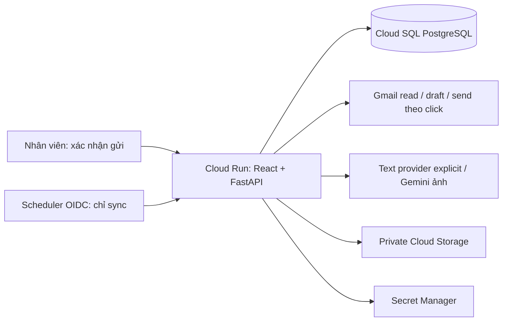

# System architecture — CURRENT → AI-first v4

Nguồn [requirements](AI_CUSTOMER_SUPPORT_REQUIREMENTS.md). Core kiến trúc v3 dưới đây được giữ; phần bổ sung này là TARGET chưa code. Baseline13 bảng là CURRENT,7 bảng extension là PROPOSED CR-001.

## CURRENT

Vite React → FastAPI → PostgreSQL; sync request gọi Gmail raw MIME và AI provider. Threading.Lock chỉ một process, token local có ghi refresh. Complaint hiện đại diện email ban đầu; chưa có multi-message workflow/send/cloud.

## TARGET

Một image cùng origin, API routers trước SPA fallback, API unknown JSON 404. Giữ framework; mở rộng component/model/router/service khi yêu cầu cần. A quản workspace/shared composition/core CaseStore/cloud; B tự làm assessment/ảnh/GCS UI/API/models; C tự làm resolution/Gmail write/lifecycle UI/API/models. Mỗi phần có tests và isolated harness theo SHARED_CONTRACTS; không chia theo tầng công nghệ. Chi tiết state tại WORKFLOW, dữ liệu DATABASE_DESIGN, wire API_SPECIFICATION.

## Intake và conversation

1. Lưu email + metadata thread/header trước AI; unique Gmail ID trong case_messages.
2. Thread đã biết → append message vào canonical case; thread mới → tạo case. Không gộp bằng mã đơn. Outbound từ chính mailbox không tạo complaint hoặc mở lại; Gmail sent ID do app gửi được dedupe.
3. Lọc query chỉ dùng khám phá thread mới. Follow-up thread đã biết được đọc riêng bằng threads.get kể cả closed và reply không keyword/không mã đơn; không lọc theo Inbox khi đọc known thread.
4. MVP polling, không bắt buộc History API: quét tối đa 20 known threads/lần theo vòng ID tăng, integration_state lưu cursor. Ưu tiên pending_thread_ids từ lượt trước, ngân sách parse tối đa 5 inbound mới/lần và tổng 240s; còn lại persist deferred. Candidate discovery dùng query bounded và Gmail page token persisted để không mắc trang đầu. Không bỏ follow-up chỉ vì query subject/time window không match.
5. Mỗi inbound mới append/audit/bump version/needs_review nguyên tử, ngay cả AI thất bại. AI context gồm latest email + tóm tắt thread + manual overrides, dữ liệu bị cắt có limitations; không đọc mỗi “Đây là ảnh” như complaint mới độc lập.
6. Reply trong thread non-complaint đã lưu: append và cho phân loại lại thread nếu nội dung mới có khiếu nại; không bỏ vĩnh viễn chỉ vì email đầu false.

last_attempt luôn cập nhật khi bắt đầu; last_success chỉ cập nhật khi một lượt bounded batch hoàn tất không fatal integration error (deferred do ngân sách vẫn hợp lệ). Lỗi provider/mailbox lưu last_error_code và không xóa last_success cũ. Discovery page token hết hiệu lực thì reset và quét lại có dedupe; known_thread_cursor tiếp tục round-robin, xóa ID deferred chỉ sau đã persist hoặc xác nhận message không đọc được có lỗi lưu lại.

## Consistency và side effects

- DB advisory lock session-scoped trên connection riêng cho sync và retry, release finally; unique ID vẫn là hàng rào cuối. Evidence có pending row unique; send/draft có operation reservation riêng.
- Business row lock + case_version cho transitions. Không giữ transaction qua network. Completion AI dùng version đã chụp: nếu manual/context đổi, giữ raw analysis nhưng không overwrite projection mới.
- Reserve send kiểm tra case/reply/decision/version, commit sending và operation trước gọi Gmail; quyết định/manual mutation bị chặn khi send đang chạy. Inbound vẫn được lưu để không mất thư; hoàn tất send không ghi đè trạng thái needs_review mới.
- Send chỉ từ authenticated explicit user request; scheduler/AI không được gọi hàm send. AI prepare không có side effect Gmail.
- Gmail và PostgreSQL không chung transaction: ambiguous network/DB failure → unknown/reconcile, không tuyên bố exactly-once.

## Cloud và giới hạn

Cloud Run mặc định 1 instance, 1 worker, concurrency 8, memory 1Gi, timeout 300s; DB lock không phụ thuộc số instance. Sync budget 240s để có thời gian persist trước timeout. Text timeout 20–30s, image 30s, batch inbound 5. A đo thời gian sync, B probe text/ảnh, C probe phản hồi/Gmail write theo phần sở hữu; không hứa 5 email luôn xong.

Cloud SQL lưu state; private Storage lưu ảnh; Secret Manager mount token readonly, refresh access token trong memory, không ghi mount. Frontend dùng relative /api, không credentials trong VITE env.

Raw decoded email cap 25 MB; không log body. Ảnh JPEG/PNG <=5 MB/ảnh, decode có pixel cap 20 megapixel để tránh decompression bomb. B đọc metadata/size trước khi tải khi có thể; payload vượt cap lưu lỗi intake rõ thay vì vô hạn. Ảnh quá lớn không hủy phần text có thể đọc an toàn. Tối đa hai ảnh/phía/request AI, chọn ảnh theo evidence_kind ở dưới; thứ tự created_at/id ổn định, lưu asset_ids snapshot. Giao diện vẫn có thể xem metadata ảnh cũ.

Draft/sending operation quá 5 phút → unknown (không reset prepared). Evidence pending quá 5 phút → failed có retry. Mọi restart phải dựa DB để biết operation, không memory flag.

## Tổ chức fullstack và Cloud Run

Schema chuẩn CLAIMPILOT_MVP_DB_V1 có13 bảng, giữ cả mốc 50%/80%/MVP. Text attempts ở text_analysis_runs; message.analysis là cache đã apply; Gmail lỗi trước parse ở gmail_intake_failures. Canonical aliases có FK riêng; reply/decision/message/operation được ràng buộc cùng hồ sơ. Đổi provider/model/key chỉ cấu hình, không schema. Xem DATABASE_DESIGN cho dictionary/constraints và DB01–DB12 trước khi triển khai BASE.

Chọn modular monolith: ba domain workspace/assessment/resolution trong cùng image React/FastAPI và một Cloud Run service. A triển khai service/SQL/Secrets/Scheduler; B quản GCS/image/text adapters của assessment; C quản Gmail write/reconcile. Không ba microservice hoặc ba database để chia việc. Cả B/C dùng shared credential factory, không tranh sửa Gmail read module A.

BASE chuẩn bị exports/registry/metadata facade/DTO/ports/test harness theo [SHARED_CONTRACTS](SHARED_CONTRACTS.md). B/C tự triển khai router/models/components/domain transactions, A chỉ aggregate migration/settings/lock và compose UI. Fake adapters/Principal chỉ isolated test app hoặc explicit development; production cấm fake/bypass auth, thiếu dịch vụ trả lỗi rõ. Core CaseStore lock/version/audit là primitive, policy thuộc B và reserve/complete gửi thuộc C. Chưa có code scaffold/harness mới trong đợt tài liệu.

Schema freeze có evidence_kind packing/delivery/customer. Với ảnh đơn ưu tiên một packing mới nhất và một delivery mới nhất; chỉ có một kind thì lấy tối đa2ảnh mới nhất của kind đó. Ảnh khách lấy tối đa2ảnh từ inbound mới nhất có ảnh. Snapshot ổn định theo created_at/id; asset đọc đúng bucket/key/generation, không nhầm ảnh đóng gói với bằng chứng giao hàng.
## Orchestration, KB và cấu hình v4
Một FastAPI composition root đăng ký workspace/assessment/resolution, thêm module knowledge do B và settings do A. Vẫn một image/URL, không6 microservices. Vai trò có thể là deterministic code hoặc LLM adapter; network chỉ qua adapter allowlist, không tool execution từ email.
A coordinator dùng persisted agent_runs/steps với bounded execution; tiến độ poll GET5s khi active, ngừng khi terminal hoặc hết60 lần, có nút refresh thủ công. Không chạy background task không bền như nguồn trạng thái; sau crash đánh dấu interrupted/stale và retry có chủ đích, không phát lại Gmail send. Sync budget240s/5 inbound/20 known threads kế thừa; phần chưa làm persist backlog.

B KnowledgeService quản content/revisions/eligibility; retrieval SQL text search (parameterized title/body/topic, limit5), chưa vector store/crawler. Trả SourceRef có pinned version/digest/excerpt; deterministic policy và order/asset DB là nguồn khác nhau, không coi KB override order facts. A settings versions/snapshot, B/C chỉ đọc via ports.
C ReplyWriter và QualityService dùng decision+permitted facts+retrieval. Check lưu dependency/content fingerprint; preview/send revalidate KB/source/settings bằng lookup ngoài network, cùng reserve UoW. Nếu cần provider check thì persist basis rồi call ngoài lock; reserve chỉ dùng kết quả đã pin còn fresh. Không provider call mới để sửa body trong send.

Không có KB/settings/run storage trong0005; CR-001 cần duyệt trước migration, riêng phiên bản đã duyệt mới phát hành. Core snapshots schema_version1 giữ nguyên; extension refs ở tables riêng, không đổi JSON legacy âm thầm.
