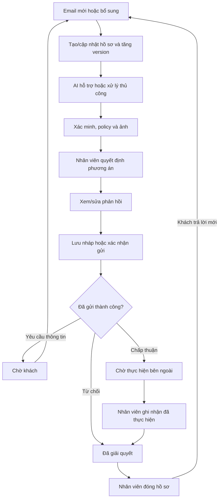

# Luồng chuẩn — AI-first v4 và lifecycle kế thừa

Nguồn [requirements](AI_CUSTOMER_SUPPORT_REQUIREMENTS.md). Các trạng thái nghiệp vụ bên dưới được giữ. Storage/API của điều phối/KB/settings/safety là extension CR-001 PROPOSED; agent status không thay enum SQL workflow/decision/reply hiện hành.

Đây là nguồn chuẩn enum nghiệp vụ. Một hồ sơ có nhiều messages, decisions, replies và audit events. Tên `complaints`/ID cũ được giữ để tương thích; UI gọi là hồ sơ. Một Gmail thread ↔ tối đa một hồ sơ trong mailbox demo. Một hồ sơ chọn một đơn; nhiều đơn/khác chủ đề được gắn needs_manual_review, không tự tách/gộp.

Storage đã chốt CLAIMPILOT_MVP_DB_V1 tại DATABASE_DESIGN. Có thêm text_analysis_runs (processing/completed/failed/stale) cho lịch sử AI và gmail_intake_failures (pending/resolved/ignored) trước khi parse được message; các trạng thái này không thay workflow_status nghiệp vụ. Canonical alias dùng canonical_case_id, không giả là non-complaint. Các mốc 50%/80% dùng cùng schema13 bảng.

## Các trạng thái độc lập

| Chiều | Enum | Ý nghĩa |
|---|---|---|
| workflow_status | needs_review, waiting_customer, waiting_fulfillment, resolved, closed | Công việc doanh nghiệp |
| processing_status | pending, processing, completed, failed | Phân tích dữ liệu, không phải hoàn tất khiếu nại |
| ownership_status | unverified, email_matched, manually_verified, mismatch | Xác minh chủ đơn; email_matched chỉ là tín hiệu |
| decision action | approve, reject, request_information | Mỗi lần quyết định là event mới |
| resolution | shipping_fee_refund, order_refund, replacement, reshipment, carrier_investigation, decline, request_information, other | Phương án doanh nghiệp chọn |
| fulfillment_status | not_required, pending, completed | Thực hiện bên ngoài app, không phải payment API |
| reply status | prepared, draft_saving, draft_saved, sending, sent, failed, unknown | Trạng thái side effect Gmail |
| reply operation status | in_progress, succeeded, failed, unknown | Mỗi intent save_draft/send có idempotency key |
| evidence status | pending, completed, failed | Job phân tích ảnh |
| consistency | consistent, inconsistent, inconclusive | Nhận xét hỗ trợ, không phải kết luận gian lận |

decision_status là projection hiện hành: undecided/approved/rejected/more_information_requested. Processing error không đưa hồ sơ ra khỏi hàng đợi nghiệp vụ. is_complaint NULL được thấy ở hàng đợi kỹ thuật; false được ẩn khỏi danh sách khiếu nại nhưng không bị xóa.

## Luồng

## Chuyển trạng thái

| Sự kiện | Điều kiện | Kết quả |
|---|---|---|
| Email inbound mới | Gmail ID chưa có | Lưu message một lần; needs_review; version+1; outbound không mở lại hồ sơ |
| Đánh giá/đính chính/xác minh/ảnh mới | Đủ input, không đang dispatch gửi | Lưu snapshot/audit; version+1; needs_review; phản hồi chưa gửi cần xem lại |
| Quyết định | version khớp; có hồ sơ complaint hoặc đã xác nhận thủ công | Append decision, current_decision_id mới; needs_review; version+1 |
| Lưu draft | Nội dung hiện hành | draft_saved; workflow không đổi, chưa chờ khách |
| Gửi request_information | Decision/reply/version hiện hành, Gmail xác nhận | waiting_customer; fulfillment not_required |
| Gửi reject | Như trên | resolved; fulfillment not_required |
| Gửi approve | Chủ đơn được xác minh; phương án cụ thể | waiting_fulfillment; fulfillment pending |
| Ghi nhận thực hiện | Latest approve đã gửi; không có inbound/context mới | fulfillment completed; resolved; audit bằng chứng thủ công |
| Đóng | resolved, latest decision đã có reply sent trả lời latest inbound; không unknown/busy hoặc inbound mới chưa xem | closed, ghi chú/audit |
| Mở lại thủ công | closed/resolved + lý do | needs_review, tăng version, lưu audit |

Approve dùng resolution thuộc shipping_fee_refund/order_refund/replacement/reshipment/carrier_investigation/other. Reject dùng decline; request_information dùng request_information và missing_fields không rỗng. Ghi chú 1..2000 bắt buộc. Approve khi ownership unverified/mismatch bị chặn; có thể xác minh thủ công có căn cứ. Policy not_eligible không khóa quyết định ngoại lệ, nhưng phải ghi lý do.

Quyết định không sửa/xóa: thêm quyết định mới và đánh dấu reply cũ stale. Nếu approve cũ đã gửi, đổi phương án cần ghi rõ quyết định mới thay thế và fulfillment trước đó trong audit; không tự đảo giao dịch. Cho phép nhiều vòng request_information → inbound → review → decision. Không tái dùng reply đã gửi cho quyết định mới.

## Version và nội dung cũ

- `case_version` tăng khi inbound mới, decision, sửa/xác minh/reassessment, evidence hoàn tất, fulfillment hoặc close/reopen. Không tăng chỉ vì người dùng mở màn hình hoặc lưu reply.
- Reply lưu `basis_case_version`, `decision_id`, `in_reply_to_message_id`, `revision`. Sửa body tăng revision. Gửi/lưu Gmail draft yêu cầu expected_case_version và expected_reply_revision khớp, cùng current decision và latest inbound.
- case_version thay đổi: reply chưa gửi trở thành is_stale=true (tính từ basis). API review-context cho nhân viên xem thay đổi, xác nhận dùng nội dung đã kiểm tra rồi cập nhật basis; không tự bỏ cảnh báo.
- Quyết định khác thì phải prepare reply mới. Review-context không được đổi decision_id của reply cũ.
- Đính chính thay đổi order/type/requested_action/ownership làm mất hiệu lực quyết định hiện hành: current_decision_id=null, needs_review; cần quyết định/reply mới, không dùng review-context để hợp thức hóa quyết định cho đơn khác. Lịch sử và hành động đã gửi/thực hiện không bị xóa.
- Reply sent là lịch sử và không có stale flag; case_version tăng vì fulfillment/close không buộc gửi lại thư. Context nghiệp vụ mới sau sent đưa hồ sơ needs_review; để giải quyết tiếp cần decision/reply mới. API review-context không sửa thư đã gửi.
- Closed không cho review/decision/reply mới cho tới reopen (thủ công hoặc inbound). Reopen không tự gửi gì. Manual review xác nhận complaint cho candidate lỗi cho phép processing_status completed với nguồn manual, không báo AI đã thành công; raw message vẫn giữ processing_error gốc.
- Không có network trong row-lock transaction. Serialize thay đổi case với bước reserve gửi; context đến sau reserve vẫn được lưu nhưng gắn cảnh báo concurrent_inbound. Không hứa hủy được email đã được Gmail nhận.

## Metadata thực hiện và lưu lịch sử

Fulfillment completed lưu time/actor/reference/note ở cột complaints đã chốt; audit/decision snapshot giữ các lần trước. resolved/closed có thời điểm và actor/lý do đóng. New inbound hoặc reopen clear closure/resolved timestamps để về needs_review, không tự đảo việc đã thực hiện. Quyết định mới reset current fulfillment completion fields nhưng giữ audit. C ghi sent reply/outbound message/operation result/audit atomic; B lưu mỗi attempt raw riêng, không dùng projection message.analysis như lịch sử duy nhất.

## Giới hạn có chủ đích

Một Gmail, một account staff, một đơn/hồ sơ, chỉ ảnh JPEG/PNG. Không multi-tenant, thanh toán, kho, video, SLA phức tạp hoặc công cụ split/merge. Mọi trường hợp vượt giới hạn có hàng đợi thủ công, không bị tự từ chối hoặc âm thầm bỏ qua.
## Điều phối AI-first v4
Chuỗi vai trò phần mềm: intake_classification → order_lookup → policy_assessment (approved KB + deterministic policy); evidence_analysis có thể song song policy khi đủ input → đề xuất để staff quyết định → reply_writer → safety_quality → staff preview/confirm send. A điều phối, B làm lookup/policy/evidence/retrieval, C làm writer/checks. Agent roles không có quyền send/approve/fulfillment/close, không phải coding subagents.

Analysis run trigger inbound/retry/manual có required roles intake_classification/order_lookup/policy_assessment và evidence nếu case cần bằng chứng. Prepare run sau staff decision có required roles reply_writer/safety_quality; cả6 roles được hiển thị theo các lượt, không đòi writer chạy trước quyết định. Coordinator giữ required_roles snapshot, skipped role mandatory làm run review_required.

AgentStep: queued→running→completed|failed|waiting_data|stale|skipped. Retry tạo attempt mới, giữ output cũ. AgentRun: queued/running/completed/review_required/failed/stale; completed chỉ khi mọi required step completed. Evidence optional không có ảnh có thể skipped kèm reason; nếu vấn đề cần ảnh để kết luận thì waiting_data và review_required. Context đổi làm output cũ stale và không publish; bước không chạy do dependency thất bại phải waiting_data với lý do, không fake hoàn tất.

Sau intake đã persist, ghi run/basis/settings trước network. Chỉ publish qua CaseStore nếu context đúng; không tự tạo quyết định hoặc gửi. Lỗi/bất đồng/nguồn không đủ/threshold không đạt giữ needs_review và manual path. Một lần publish business mutation chỉ bump case_version một lần; heartbeat/progress không bump. Confidence thiếu/không kiểm chứng để null; không dùng làm căn cứ approve.

## Knowledge Base và settings
KB draft→pending_review→approved→archived; chỉnh approved tạo draft revision mới, duyệt riêng. Retrieval chỉ current published approved, chưa hết valid_until/review_due_at và không has_conflict. Không kết quả/mâu thuẫn thì báo thiếu căn cứ, không invent policy. Citation pin ID/revision/digest/excerpt; đọc history đúng bản đã dùng. Single staff account không giả review bởi người thứ hai.
Settings immutable version; optional evidence role có thể tắt, mandatory roles và guardrails không tắt. Threshold null mặc định, numeric nếu cấu hình0..1 chỉ dùng với validated score; thiếu score chuyển review. Run mới dùng current settings; reply/run cũ giữ snapshot.

## Quality và xác nhận nội dung
Writer chỉ chuẩn bị sau staff decision, pin nguồn/settings. Manual reply cũng cần safety_quality. Safety gồm recipient/ownership, nguồn/claim/amount, prompt injection, không hứa refund đã thực hiện, current context; policy/nguồn mâu thuẫn là blocker. Có thể sửa sang yêu cầu thông tin trung tính dựa trên khách/decision khi thiếu KB; phải check lại, không có nút bỏ qua guardrail.
passed check không gửi. Preview pin toàn bộ dependency + case/reply revision/content. Staff send xác nhận token preview này; edit/new inbound/KB/config dependency đổi thì check/token stale, cần xem/check lại. Tại reserve revalidate nguồn và token; giữ luồng reserve→Gmail→complete hiện hành. Unknown không auto resend. Sent là history, không bị thay bởi publish KB/settings sau đó.
